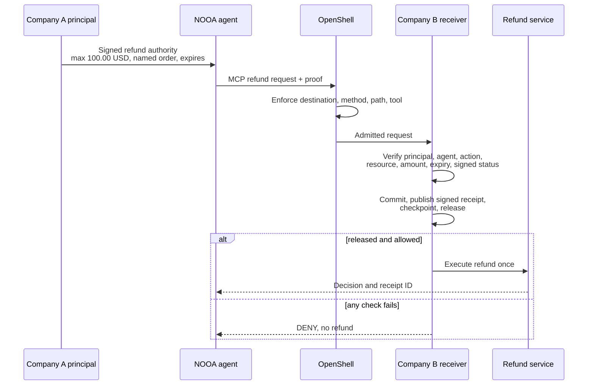

# Proof-Carrying Delegated Authority

**An agent asks another company's service to move money. The service verifies who authorized that agent, for exactly this action, within exactly these limits, before it acts.**

A working reference contribution for [NOOA](https://github.com/NVIDIA-NeMo/labs-OO-Agents) and NVIDIA's open agent-security stack, built on [Ratify Protocol](https://github.com/identities-ai/ratify-protocol).

**Protocol line.** This reference runs on Ratify Protocol v2, built from this source tree (`ratify_protocol.v2` from `ratify-protocol` `2.0.0b1` with its `protocol-v2` extra, and `ratify-protocol-native-v2` `2.0.0b1`, ahead of the published `2.0.0-beta.1` packages). The runs recorded below used the earlier separate `ratify-protocol-v2` distribution of the same SDK, before it moved into `ratify-protocol` on 2026-10-28. Its deterministic gate passes 192/192 on v2 (re-run on 2026-10-27 at `2.0.0b1`), and one live OpenShell profile run passed 64/64 gates (52 required cases, 2026-10-22, on the earlier in-tree alpha.1 build), both pre-release against the SDK built from this checkout. The Protocol v1 results (181 tests, and the live OpenShell profile at 64/64 gates on `ratify-protocol==1.0.0a20`) are kept as dated history in [`docs/evidence/nvidia-reference-evidence.md`](../../docs/evidence/nvidia-reference-evidence.md). The v2 records are [`references/nvidia-nooa-openshell/evidence-v2-2026-10-27.md`](../../references/nvidia-nooa-openshell/evidence-v2-2026-10-27.md) (deterministic gate) and [`references/nvidia-nooa-openshell/evidence-v2-2026-10-22.md`](../../references/nvidia-nooa-openshell/evidence-v2-2026-10-22.md) (first v2 record and the live profile).

**Development only.** The receiver uses the SDK's in-memory reference stores for its claim store, receipt log, checkpoint, security journal and challenge issuance. They are not durable, do not survive a restart, and share the verifier's failure domain. A production receiver supplies durable Part B stores and an independent checkpoint (SPEC-v2 §7).

No API key, no model, no paid service. Until the v2 packages are published, the native signing extension builds from source, which needs a Rust toolchain:

```bash
python3.12 -m venv .venv && source .venv/bin/activate
pip install 'maturin>=1.7,<2'
(cd sdks/python-native-v2 && maturin build --release --out ../../dist-native)
pip install dist-native/*.whl -e 'sdks/python[protocol-v2]'   # TODO(RATIFY_V2_PIN): pip install "ratify-protocol[protocol-v2]==2.0.0b1"

python demos/nvidia-nooa-delegated-authority/scenarios.py
python -m pytest demos/nvidia-nooa-delegated-authority/test_verification.py -q
```

The authoritative gate builds its own clean environment, requires every optional integration, and fails on any skip or unexpected count:

```bash
PYTHON=/path/to/python3.12 ./demos/nvidia-nooa-delegated-authority/reference-check-v2.sh
```

---

## Why this exists

A refund agent runs at Company A. It calls a payments service at Company B.

Company A's principal intended something precise: *this agent may issue refunds up to $100, for the next 24 hours.*

By the time the request arrives at Company B, that intent has usually collapsed into an API key in a header. Company B learns that some caller holding some credential wants $150 refunded. It does not learn who authorized the agent. It does not learn that the ceiling was $100 rather than $10,000. It does not learn whether the authority was revoked ninety seconds ago. And it cannot tell whether the agent presenting the credential is the agent the credential was issued to.

Company B executes the refund and absorbs the loss. **The party carrying the risk has the least evidence of anyone in the chain.**

That inversion is what this reference addresses. The principal's limits are signed, they travel with the request, and the receiving service verifies them before acting. A misconfiguration or prompt injection inside Company A stops being Company B's liability.



## Where it fits

NVIDIA's open stack already answers most of the questions worth asking about an agent. This reference addresses one that sits alongside them.

| Layer | Question it answers | Who authors the answer |
|---|---|---|
| **NOOA** | What is the agent doing, and how is it traced? | The agent's operator |
| **NeMo / guardrails** | Does this interaction comply with enterprise policy? | The enterprise, centrally |
| **OpenShell** | What may this runtime reach, via which MCP method and tool? | The runtime's operator |
| **SPIFFE/SPIRE** | Which workload is calling? | The trust domain |
| **Ratify Protocol** | Who authorized this agent for this action, within what limits? | **The principal, in another organization** |

The last row is the distinction worth pausing on. Every other layer is authored and enforced by the party running the infrastructure. A delegation proof is authored by a principal who may be in a different company entirely, and it is verified by a receiver that has never spoken to that principal's systems. That is what makes it portable evidence rather than local configuration.

Ratify Protocol replaces none of these layers. Workload identity still authenticates the caller. Guardrails still evaluate the interaction. Policy engines still apply local rules and may still deny. This layer establishes that authority exists and is in scope; everything else keeps its job.

## How the workflow runs

The agent describes what it wants. The receiver decides what the request *is*, and then whether to honor it.

### Phase 1: the receiver defines the operation

```
agent  ──▶  POST /refunds/challenge   { order_id, amount_micros, currency, agent_id, agent_public_key }
```

The receiver takes the agent's word for nothing. It requires the amount as an integer number of micro-units (100.00 USD is `100000000`), checks that `agent_id` is the key ID of `agent_public_key`, chooses the scope the operation requires, canonicalizes the resource, derives the v2 operation context and session context, and issues a challenge with the SDK's issuance helper. The helper persists the expected-challenge record, bound to the agent's complete key and the session context, *before* it returns the challenge.

```
agent  ◀──  { challenge, issued_at, expires_at, session_context, verifier_id }
```

### Phase 2: the agent proves possession, the receiver decides

```
agent  ──▶  POST /refunds   { challenge, proof }
```

The agent signs a v2 proof bundle over the receiver's challenge, issuance time, verifier ID and session context, and sends its exact wire bytes. The receiver loads its issuance record by the challenge *it* is handed, then runs `verify_proof_bundle_v2`:

1. **Preflight, before any claim.** Strict decode; the proof answers this exact challenge at this exact issuance time; the challenge is fresh on the receiver's clock; the presenting key is the agent the challenge was issued to; the session context is the one the receiver derived; the agent's signature verifies. Any failure here is an unsigned refusal, and the legitimate holder's challenge survives.
2. **Atomic claim.** The claim store records the challenge once. A second presentation is a replay and is never evaluated.
3. **Trust.** The chain must terminate at the principal this receiver configured, pinned to the complete hybrid key.
4. **Signed status.** Revocation status comes from objects signed by the principal's status key, a key separate from its root key, verified and applied to the receiver's security journal. Status is per issuer: every issuer in the chain needs a configured status key.
5. **Scope and constraints.** `payments:send`, the `max_amount_micros` ceiling against the receiver's `requested_amount_micros` and `requested_currency`, and any `resource_path` constraint against the receiver's own canonical resource.
6. **Commit, publish, release.** The committed result is signed as a v2 verification receipt, appended to the receipt log, acknowledged by the checkpoint, and released.
7. **Act.** The refund executes only if the released decision says `allowed` at the receiver's own clock.

```
agent  ◀──  { decision, status, reason, refunded_micros, receipt_id }
```

**Authority can name the resource it covers.** *"Refund up to $100"* and *"refund up to $100 for this order"* are very different grants. Without the second, an agent authorized to refund one customer can refund every customer, one order at a time, never exceeding the ceiling. A `resource_path` constraint lets a delegation name the single resource it authorizes.

The protocol treats `resource_id` as an opaque string compared by **exact byte equality**, with no case folding, percent-decoding, or normalization of any kind. Canonicalization is the application's responsibility: an application that accepts two spellings of one resource has two resources as far as verification is concerned. This receiver therefore pins a single tenant-qualified form, `tenant/acme/orders/ord-9`, rejects anything that does not fit it, and uses that one value for both the session binding and the constraint. Tenant qualification is not decoration. Two tenants can each have an order numbered 8841, and a delegation naming a bare `8841` would authorize both. A resource constraint evaluated with no resource context fails closed as `constraint_unverifiable`.

**The critical property: the agent's process contains no authorization logic.** The NOOA adapter presents a proof and reports a verdict. It cannot allow anything. An agent-side check would be worthless as a control, since a compromised or misaligned agent simply would not run it. The reference therefore has no such check, not even an advisory one, and a test asserts its absence.

## What the reference proves

Each denial is asserted against a specific status or reason, so none of them can pass by accident. "Refused" means refused before the claim: no receipt, and the challenge is not consumed.

| Attempt | Result |
|---|---|
| 75.00 USD refund inside a 100.00 USD bound | `authorized_agent`, released and allowed |
| 150.00 USD against the principal's 100.00 USD ceiling | `constraint_denied` |
| Delegation that lapsed an hour ago | `expired` (`delegation_expired`) |
| Delegation the principal revoked by signed status | `revoked` (`delegation_revoked`) |
| Status feed unreachable | `authorization_unverified` (`status_unavailable`), fails **closed** |
| Status list already expired when it arrives | `status_unavailable`, fails closed |
| Clean status list signed by a key other than the configured status key | denied; cannot un-revoke |
| Certificate presented by a key it was not issued to | refused, `chain_linkage_mismatch` |
| Agent identity claimed by a key that cannot sign for it | refused, `invalid_signature` |
| A valid presentation replayed | refused, `claim_replay` |
| Amount restated in the execution request | ignored; the receiver's parse stands |
| Proof captured and reused under a fresh challenge | refused, `challenge_mismatch`; the victim's challenge survives |
| Proof bound to a different operation | refused, `session_context_mismatch` |
| Challenge issued to one agent, spent by another | refused, `expected_agent_mismatch` |
| Child certificate claiming scope its parent never held | `scope_denied` |
| Child certificate raising the parent's ceiling tenfold | `constraint_denied` |
| Intermediate issuer with no configured status key | `status_unavailable`, fails closed |
| Refund for an order the delegation does not name | `constraint_denied` |
| Another tenant's order with the same local number | `constraint_denied` |
| Non-canonical order id (traversal, spaces, over-length) | `400 malformed` before a challenge is issued |
| Resource constraint with no resource context supplied | `constraint_unverifiable`, fails closed |
| Subdelegation without `identity:delegate` | `delegation_not_authorized` |
| Chain rooted at a principal the receiver never configured | `unauthorized`, receipt records `trust_assessment: untrusted` |
| Twelve concurrent decisions | one unbroken, verifying receipt log; no lost refunds |
| Twenty-five fabricated presentations against unissued challenges | zero receipts appended |
| NaN, infinite, fractional, negative, or zero amount | `400 malformed` before a challenge is issued |
| A float or NaN spliced into a signed `max_amount_micros` | refused, `malformed`; never claimed |
| Malformed JSON, array body, bad base64, wrong types | deterministic `4xx` |

**192 tests: 188 hermetic and 4 mandatory NOOA integration tests** (64 receiver security, 40 MCP transport, 84 adjudicator, 4 NOOA). The hermetic suite needs neither NOOA nor an LLM nor a container runtime, so the security claims are verifiable from a clean checkout. The NOOA tests exercise the real released middleware API, and `reference-check-v2.sh` requires them to run rather than permitting them to skip.

## The live OpenShell profile

`run-openshell-profile.sh` executes the whole composition against a pinned, validated OpenShell v0.0.102 CLI and gateway stack. It requires Docker (or a compatible daemon), OpenShell CLI `0.0.102`, Python 3.12, OpenSSL 3 for Ed25519 key generation, a Rust toolchain on the host, and network access to build the v2 native signing extension for the sandbox's Linux architecture (in a pinned `ghcr.io/pyo3/maturin` builder image). On macOS, set `OPENSSL_BIN` explicitly if `/usr/bin/openssl` is not OpenSSL 3:

```bash
OPENSSL_BIN=/opt/homebrew/opt/openssl@3/bin/openssl \
PYTHON=/opt/homebrew/bin/python3.12 \
./demos/nvidia-nooa-delegated-authority/run-openshell-profile.sh
```

`RATIFY_SDK=published` is reserved for the published `2.0.0-beta.1` packages and does not work until they are on PyPI and pinned in `sandbox-requirements.in` (`TODO(RATIFY_V2_PIN)`).

**Status on Protocol v2.** One live run on 2026-10-22 passed 64/64 gates with all 52 required cases, against the v2 SDK built from this checkout (pre-release; not yet repeated against published packages, and the v1 concurrent and failure-injection campaigns were not repeated). See the [v2 evidence record](../../references/nvidia-nooa-openshell/evidence-v2-2026-10-22.md).

> NOOA agent → proof-carrying MCP Streamable HTTP → OpenShell destination, method, and tool enforcement → an independent MCP receiver → Ratify semantic authorization → consequential action → signed receipt

One command from a clean checkout brings the gateway up on dynamic ports from immutable image digests, renders the sandbox policy, drives **52 cases in seven isolated groups** from inside an OpenShell sandbox, audits every log source for per-run canaries, writes a machine-readable artifact, and removes exactly what it created. It takes several minutes. It is deliberately **not** part of the deterministic gate.

| Group | What it establishes |
|---|---|
| `positive_and_replay` | The one path that may move money, and that replaying the same presentation cannot move it again |
| `ratify_semantic_denials` | Denials OpenShell cannot see and is not asked to (amount, resource, tenant, expiry, revocation, status failure, wrong key, untrusted root, scope and constraint amplification, cross-request proof movement, invalid challenge, malformed proof), plus two authorize controls that isolate what is actually causing them |
| `maximum_depth` | An eight-certificate v2 chain carried inline in `_meta` and authorized |
| `size_boundaries` | Three independent limits, each enforced by a different component against a different quantity; a nine-certificate chain does not decode under v2 and is refused at the MCP boundary |
| `parser_differentials` | Fifteen probes of one invariant: admitted as X, never dispatched as Y. A separate coverage gate requires the matrix to have actually exercised both the admission and the denial branch, since the invariant alone is satisfiable by a policy that denies everything |
| `destination_path_port` | Unauthorized destination, wrong port, wrong path, unlisted tool, disallowed method, and the control endpoint, all refused before MCP ingress |
| `nooa_full_path` | The composed path: one NOOA capability call, carried over MCP through an OpenShell policy to an independent receiver, authorized by Ratify, in a single process that imports `nooa` exactly once, measured by an import audit hook rather than declared |

`log_canaries` is a separate, non-adjudicated pass: it re-exercises cases from the groups above so the log audit has each shape of traffic to search against. The gate is the canary search, not a per-case verdict.

**Protocol v1 stability record (dated history).** All seven groups passed 64/64 gates in a live OpenShell v0.0.102 compatibility run against the published `ratify-protocol==1.0.0a20` on 2026-09-18; the same package passed all 181 Protocol v1 hermetic and NOOA integration tests. The earlier v0.0.96 campaign remains historical evidence for that older pinned stack. See [`docs/evidence/nvidia-reference-evidence.md`](../../docs/evidence/nvidia-reference-evidence.md), including a disclosed, bounded retry added for a transient `sandbox download` flake under concurrent load.

**How a case is judged.** Each case declares its expected outcome (`authorize`, `deny_at_openshell`, `admit_as:<tool>`, or `deny_at_ratify:<status>`) and every boundary delta it may produce. The runner takes a snapshot of the receiver's counters immediately before and immediately after that case, from a loopback control endpoint the sandbox cannot reach, and compares. A missing case, a missing snapshot, a stale sequence number, a partial result, or an event the deltas do not account for is a **failure**, never a skip. No gate can pass because a record merely exists: `test_adjudicator.py` feeds the adjudicator evidence of each violation in turn and asserts it says FAIL.

**What one run proves, and what it does not.** The artifact records component digests, the resolved platform digest, the executed architecture, policy and gateway configuration hashes, every case with its expected and actual outcome, per-case boundary deltas, proof sizes and hashes, the log sources inspected with canary hit counts, and an explicit `not_executed` list plus enumerated `known_limitations`. It never contains a private key, a full proof, or a JWT. Claims about architectures, runtimes, or configurations that were not executed are recorded as limitations rather than results.

## Files

| File | Role |
|---|---|
| `principal.py` | Creates authority: keys, delegations, and signed status under a separate status key. |
| `refund_service.py` | **The receiver.** Issues challenges, verifies, commits, publishes receipts, releases, and acts. |
| `agent_client.py` | Carries the proof and answers the challenge. Decides nothing. |
| `adversary.py` | Hand-built presentations the SDK will not sign, for tests and the harness only. |
| `nooa_adapter.py` | NOOA presentation adapter, via `intercept("agent_call", ...)`. |
| `scenarios.py` | The narrated run. |
| `mcp_server.py` | The MCP Streamable HTTP boundary. Contains no authorization logic. |
| `openshell_probe.py` | The receiver, the append-only event log, and the loopback control plane. Holds every private key in memory and never serializes one. |
| `openshell_client.py` | Runs inside the sandbox. Sends one case, reports what happened, interprets nothing. |
| `openshell_cases.py` | Case expectations and the adjudicator. Pure functions over recorded evidence. |
| `openshell_driver.py` | Orchestration: bounded external calls, per-case snapshots, the artifact. |
| `run-openshell-profile.sh` | Environment setup and teardown around the driver. |
| `reference-check-v2.sh` | The deterministic v2 gate. |
| `test_verification.py` | 64 hermetic receiver-security tests. No NOOA, no LLM. |
| `test_mcp_transport.py` | 40 hermetic MCP transport and proof-carriage cases. |
| `test_adjudicator.py` | 84 cases proving the adjudicator fails each incomplete or inconsistent evidence shape. |
| `test_nooa_presentation.py` | 4 tests against released NOOA. |

## The NOOA integration seam

`agent.event_manager.intercept("agent_call", fn)` from `nooa.runtime.middleware`. Public API, exported in `__all__`, documented in NOOA's own `skills/nooa-middleware-hooks/SKILL.md`, and covered by `tests/test_event_middleware.py`. The module in released `nooa==0.0.8` is byte-identical to `main`.

NVIDIA established this pattern for third-party security integration: `src/nooa/nemo_flow_middleware.py` routes agent calls through NeMo Flow guardrails using the same three middleware kinds. This adapter deliberately mirrors that shape.

The agent capability is an ordinary `async` method, so NOOA dispatches it without an LLM round-trip. `FakeLLMClient`, NOOA's public double for hermetic testing, satisfies the constructor. The test suite subclasses it to raise if a call is ever attempted, which makes "no LLM" a tested property rather than a claim.

`InstrumentationHooks` was considered and rejected on two grounds. Its exceptions are swallowed by design, so it cannot block. And it occupies a single contextvar slot that `enable_tracing()` already uses, so installing hooks there would silently disable NOOA tracing. Both facts come from NOOA's own documentation.

## What this does not claim

A reference that overstates itself is worse than no reference, so the limits are explicit.

**The stores are development only.** Claim store, receipt log, checkpoint, journal and challenge issuance are the SDK's in-memory reference stores. Replay protection holds within one process; nothing survives a restart. A multi-host deployment needs durable Part B stores whose claim is atomic across nodes.

**Receipts are the verifier's own signed assertion**, bound by hash to the exact proof presented and linked into a sequenced log whose previous-receipt digests make modification, interior removal, reordering and forking detectable. Deletion of the tail is caught only by something outside the verifier: an independent checkpoint, a witness, or another party holding a later log head. The checkpoint in this reference is the reference store itself, in the verifier's failure domain, so it does not provide that independence. Receipt signing-key custody is out of scope. This is not third-party attestation. A dishonest verifier can sign whatever it likes.

**Receipts cover committed decisions only**, at most one per issued challenge. A presentation refused in preflight (wrong challenge, stale, wrong agent key, wrong binding, bad signature, malformed) or replayed produces an unsigned, bounded operational-log entry instead. Otherwise an unauthenticated caller could append signed entries at will and bury real decisions in noise.

**What a receipt asserts about identity.** v2 verifies the agent's challenge signature before the claim, so every receipt's `agent_id` is a proven key. A receipt never asserts a principal: it lists the presented issuers, grants no scope on a denial, and records the trust, status and context assessments the verifier actually completed.

**Non-amplifying subdelegation works by intersection, not rejection.** A child certificate claiming a scope its parent never held is not refused as malformed. The amplified scope never enters the effective set, so the action denies as `scope_denied`. Constraints are evaluated conjunctively, so a parent's 100.00 USD ceiling still binds a child that wrote itself a 1000.00 one.

**Amounts.** Protocol v1 carried amounts as floats, and every ordered comparison against NaN is false, so a NaN amount cleared any ceiling; an earlier version of this reference authorized a NaN refund. Protocol v2 has no floats on the wire: `max_amount_micros` and `requested_amount_micros` are integers, and a float or NaN anywhere in a proof does not decode. The receiver holds its own request input to the same rule and refuses non-integer, non-positive and implausibly large amounts as `malformed` before issuing a challenge.

**Two things sit outside the threat model.** A compromised receiver executes the action and signs its own receipts, so no protocol can stop it lying about its own decision. And a compromised agent runtime, operating *within the bounds already delegated*, can issue refunds up to $100 until expiry or revocation. This layer bounds the blast radius and makes it revocable. It does not eliminate it.

## Environment

Requires Ratify Protocol v2: `ratify-protocol` `2.0.0b1` with its `protocol-v2` extra, and `ratify-protocol-native-v2` `2.0.0b1`, built from this checkout (TODO(RATIFY_V2_PIN): the published `2.0.0-beta.1` packages). All 192 tests pass with `nooa==0.0.8`, `mcp==2.0.0` and `uvicorn==0.52.1` on Python 3.12 via `reference-check-v2.sh`, which fails on any skip and asserts that `ratify_protocol.v2` resolves inside this repository in `local` mode (outside it in `published` mode). The receiving service uses only the Python standard library plus the SDK, because a protocol reference should not need a web framework to be understood. Apache-2.0.

## Beyond this reference

Two directions extend the same receiver-side pattern. Neither is implemented here, and neither is claimed.

**SPIFFE workload identity.** Bind the authenticated workload identity into the session context, so a valid delegation replayed from a different workload fails cryptographically rather than by policy. This is a specification change requiring protocol review, which is why it is deliberately absent from a demonstration.

**Physical AI (Protocol v1; returns in v2.1).** Protocol v1 has geofence and speed constraints that the same verifier evaluates alongside monetary ones. Protocol v2.0 has no geofence, speed or kinematic constraint; they return in v2.1. On v1, the pattern would extend to an actuation boundary on Jetson or IGX, where a principal delegates a bounded mission and the actuation service verifies it before commanding motion. That requires hardware, latency measurement, and a safety analysis, none of which exist yet.

---

Architecture, threat model, and open questions for NVIDIA engineers: [`docs/nvidia-open-secure-ai-reference-proposal.md`](../../docs/nvidia-open-secure-ai-reference-proposal.md) (written against Protocol v1). Protocol v1 evidence, hashes, and known limitations: [`docs/evidence/nvidia-reference-evidence.md`](../../docs/evidence/nvidia-reference-evidence.md). Protocol v2 evidence: [`references/nvidia-nooa-openshell/evidence-v2-2026-10-22.md`](../../references/nvidia-nooa-openshell/evidence-v2-2026-10-22.md).

Ratify Protocol is published by Identities.AI, Inc., and is a member of NVIDIA Inception. This is an independent reference implementation. It is not an NVIDIA partnership, not an approved or official integration, not an NVIDIA reference architecture, and not an Open Secure AI Alliance membership artifact. No NVIDIA repository is modified by this contribution. Every live result comes from executions recorded in the profile's own artifact, on the single platform recorded there: arm64 macOS with Docker. linux/amd64 and Podman are compatibility targets, not results.
