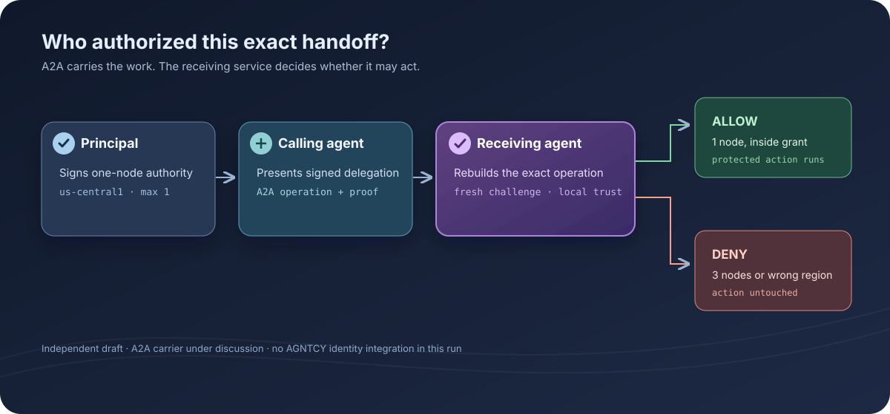
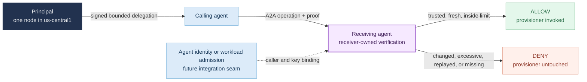
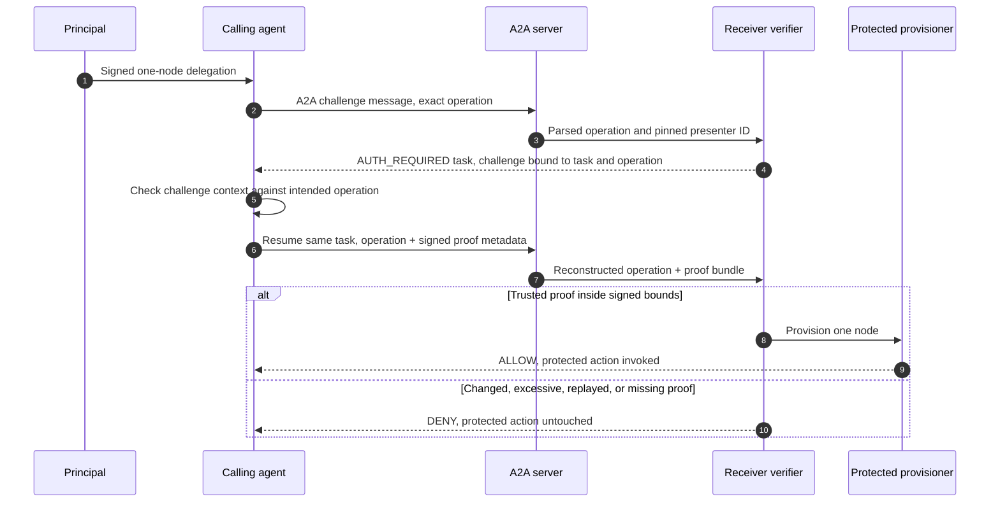

# A2A authority proof of concept: verify the handoff before the action

**Let an agent hand work to another organization without turning access to that agent into unlimited authority.**

This independent Ratify draft uses A2A 1.0 messages to carry a bounded provisioning request and its proof to a receiving agent. The receiver verifies the exact operation before calling its protected provisioner. It is a discussion artifact, not an A2A-approved extension, Google integration, Cisco integration, or production deployment. [Run it](#use-it-now) · [Inspect the evidence](#what-the-reference-proves) · [Choose a path](#which-path-should-i-use)



## Why would a developer or enterprise need this?

A2A provides agent discovery, interoperable messaging, task handling, and extension negotiation. Its server authenticates and authorizes callers under local policy. For a consequential action, the receiving organization may also need evidence that a recognized principal authorized this specific action within signed limits. A2A's in-task authorization section leaves the scope and representation of that evidence to an implementation, issuer, or extension.

| Question | A2A and identity controls | Ratify in this draft |
| --- | --- | --- |
| Which agent connected? | Transport authentication and potentially an agent identity credential | The HTTPS gate requires a caller bearer token and pins one expected presenter ID; it does not bind the token to the Ratify key |
| Can the caller send an A2A message? | Server policy decides | Not Ratify's purpose |
| Did a principal authorize this operation and ceiling? | Not defined by the A2A message alone | A signed chain is checked against the receiver-constructed operation |
| Should the receiving organization execute? | Its own policy and handler decide | The receiver calls the handler only after verification allows |



This matters when the caller belongs to another organization, a workload credential is broader than the current task, or an intermediary narrows a principal's grant before the receiving agent acts.

## Who implements what

| Role | Decision and work |
| --- | --- |
| Principal | Signs a bounded delegation for the agent. The fixture issues a one-node, one-region grant. |
| Calling agent operator | Holds the delegated agent key, requests a receiver challenge, checks its operation binding, signs it, and carries the proof in A2A message metadata. A Node wire client sends the HTTPS A2A messages in the network test; a separate Python caller holds the signing key. No model participates. |
| Receiving agent operator | Runs a separate HTTPS process in the network test, requires a bearer token, pins the trusted principal root and expected agent, binds the A2A task and context IDs, checks revocation and local policy, then guards the provisioner. |
| A2A | Supplies the Agent Card, extension negotiation, structured messages, and JSON-RPC transport. No A2A core modification is needed for this experiment. |
| AGNTCY Identity and TBAC | Existing identity and tool-level policy work to compare with this authority check; AGNTCY is also designing a task authorization profile with substantial overlap. No AGNTCY code runs here. See the [comparison note](AGNTCY_A2A_FIT.md). |

## What does this reference do?

The principal's signed grant in the fixture is limited to:

```text
scope          custom:infra:provision
resource       gcp:customer-project:us-central1
max_nodes      1
receiving act  infra.provision
```

The grant does not limit instance type or cost. A real provisioning policy must
set those limits before this example can guard billable infrastructure.

The receiving agent accepts a structured A2A `DataPart` with a region, instance type, count, and request ID. Count is carried as a canonical decimal string because protobuf `Value` represents JSON numbers as doubles. The receiver converts and validates it before constructing the operation.



The `A2A-Extensions` request header activates a provisional Ratify URI advertised as required in the Agent Card. Missing activation returns A2A's `ExtensionSupportRequiredError` before execution. The authority proof is stored under that URI in message metadata. The business operation remains in the data part.

## What the reference proves

| Wire-level case | Decision | Protected provisioner |
| --- | --- | --- |
| One node in the signed region | Allow | Called once |
| Reuse on the completed task | A2A error `-32004` | Not called again |
| Reuse of a proof on a new task for the same operation | Deny | Not called again |
| Three nodes under a one-node grant | Deny | Not called |
| Region changes after challenge issuance | Deny | Not called |
| Required extension not activated | A2A error `-32008` | Not called |
| Proof missing | Deny | Not called |
| Caller receives a challenge for a different instance type | Refuses to sign | Not called |
| Proof from another pending operation | Deny | Not called |
| Local HTTPS receiver, independent Node client, valid token and proof | Allow | Called once |
| Missing or wrong bearer token, or untrusted TLS certificate | Refused | Not called |

The focused gate has six deterministic tests and zero skips. Five tests exercise A2A 1.0 JSON-RPC through the official Python server routes in-process. The network test starts a separate HTTPS receiver and uses an independent Node JSON-RPC client. It checks TLS trust, caller bearer authentication on a valid execute request, task resumption, a valid protected action, and denial of a proof copied to another task. A changed region fails the pending-operation comparison. Reuse after completion is rejected by A2A's terminal task handling; reuse on a new task reaches the receiver and is denied. The broader ADK suite tests the underlying cryptographic verifier separately.

## Use it now

You need Python 3.10 or newer, `pip`, Node.js 22 or newer, OpenSSL, and network access to install pinned published packages. The network test listens only on local loopback and generates a short-lived test certificate and bearer token. No Gemini key, Google Cloud project, Discord account, or external service is needed. From a clean Ratify Protocol checkout:

```bash
./scripts/a2a-reference-check.sh
```

The script installs into `references/a2a/.venv`, verifies package versions and that Ratify comes from the published package, then runs the wire-level tests. It installs the pinned ADK and MCP dependencies because this draft reuses the existing ADK scenario's receiver package; no ADK agent or MCP server runs in the A2A tests. The HTTPS test needs permission to bind a local port.

## Which path should I use?

Use this open reference to inspect and challenge the proposed A2A carrier and receiver boundary. The authority format and verifier are open source. [Register interest in Ratify Verify](https://ratifyprotocol.com/?intent=proof#partners) if you need operated trust distribution, revocation freshness, durable replay state, audit retention, or a supported deployment adapter. Both paths use the same authority proof semantics.

## What is cryptographically bound?

The principal signs the agent delegation, scope, resource, node ceiling, and expiry. The receiver returns the fresh challenge and inputs for a session context containing its verifier ID, workspace, expected agent, session, invocation, and hash of its constructed operation. Before signing, the calling agent recomputes that hash from its intended operation, checks the workspace and agent, and rebuilds the session context. The operation's canonical payload includes the A2A task and context IDs from the SDK's request context as well as the request fields. A client may choose the initial context ID; the SDK creates the task ID and validates task resumption. The receiver pins the principal's public root, checks the chain and revocation state, consumes the challenge once, and applies the one-node constraint before the protected call. The principal's grant still does not restrict every payload field.

The A2A `DataPart`, message ID, header, and metadata placement are carrier details, not themselves a Ratify signature. The receiver constructs the operation from parsed data and SDK task identity and compares it with the pending challenged operation. The task and context IDs enter the signed session context through the operation hash; the message ID does not.

## Repository map

| File | Purpose |
| --- | --- |
| [`poc.py`](poc.py) | A2A Agent Card, extension gate, challenge and execute message adapter |
| [`serve.py`](serve.py) | Separate HTTPS receiver entry point for the network gate |
| [`wire_client.mjs`](wire_client.mjs) | Independent Node A2A JSON-RPC caller for the network gate |
| [`tests/test_poc.py`](tests/test_poc.py) | A2A wire allow and deny assertions with protected-call counts |
| [`requirements.txt`](requirements.txt) | Published dependency pins |
| [`../../scripts/a2a-reference-check.sh`](../../scripts/a2a-reference-check.sh) | Clean-checkout gate |
| [`AGNTCY_A2A_FIT.md`](AGNTCY_A2A_FIT.md) | Short layer comparison and questions for maintainers |
| [`../google-adk/authority_reference/receiver.py`](../google-adk/authority_reference/receiver.py) | Reused receiver-owned challenge, verification, and protected-action boundary |

## Evidence, security status, and limitations

Executed locally with `a2a-sdk==1.2.2`, `ratify-protocol==1.0.0a20`, Python 3.11, Node 22, OpenSSL, and the pinned ADK scenario dependencies. The six tests pass with zero skips. This is an independent draft for technical discussion. The provisional extension URI has not been registered or accepted by A2A, and this profile has not been reviewed or endorsed by A2A, Google, Cisco, AGNTCY, or Microsoft.

- The network gate uses local HTTPS with a generated test certificate and bearer token. It proves transport enforcement in the fixture, not OAuth issuance, mutual TLS, AGNTCY identity verification, or binding the bearer token to the Ratify agent key. The caller validates the TLS certificate, but does not independently pin the receiver's Ratify verifier ID.
- The challenge and execution form an in-memory A2A task with `AUTH_REQUIRED` followed by completion. The task ID and context ID are signed through the operation hash, but the task store is not durable. Whether the authority proof belongs in this provisional extension or an AGNTCY task authorization profile remains open for community review.
- The challenge and pending-operation stores are in-memory in one receiver process. An authenticated caller can occupy the 128 pending-operation slots or reserve a predictable request ID for up to five minutes. The executor does not support cancellation; the A2A SDK may mark a waiting task canceled without releasing its pending challenge before that TTL. Multi-replica atomicity, durable revocation, key custody, rate limits, and production audit storage are not implemented.
- The protected provisioner is in-memory and creates no cloud resource. A real executor must ensure the verified logical resource maps to the actual resource it changes.
- The network test runs separate caller and receiver processes on one host and uses an independent Node JSON-RPC client. It does not prove interoperability with another vendor's deployed A2A agent or use a second vendor's SDK.
- The current carrier imports the published ADK scenario's Python package, which brings ADK and MCP dependencies into this draft. A standalone adapter would extract that shared receiver and drop those unrelated dependencies.

Sources: [A2A extensions](https://a2a-protocol.org/latest/topics/extensions/), [A2A authorization scope](https://a2a-protocol.org/latest/specification/), [AGNTCY identity](https://spec.identity.agntcy.org/docs/intro/).
