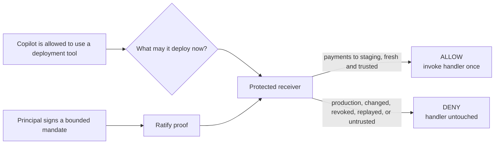
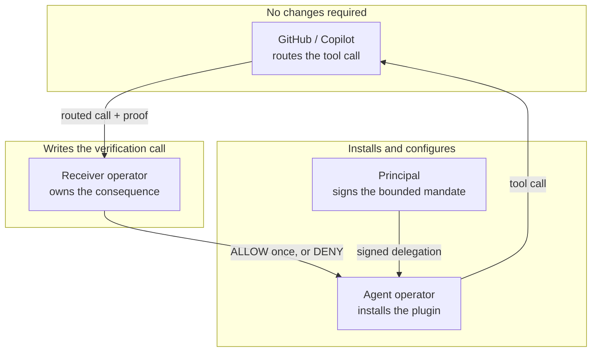
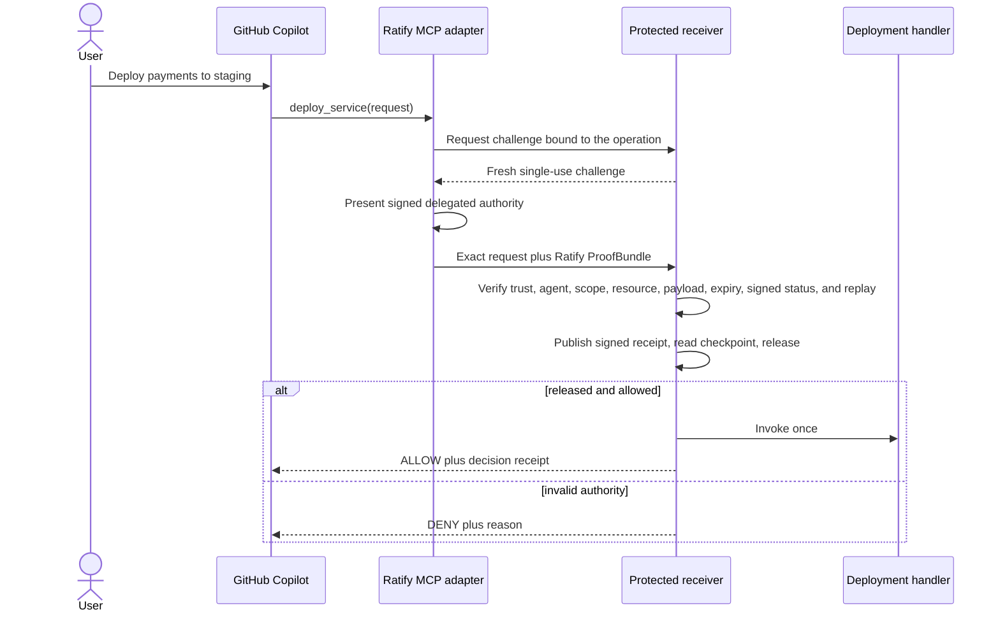
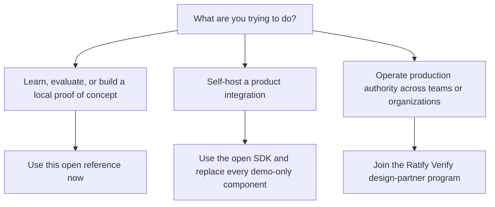

# Receiver-verifiable authority for GitHub Copilot

**Let GitHub Copilot use consequential tools without treating access to a tool
as unlimited authority.**

This live, open reference shows a GitHub Copilot plugin invoking an MCP
deployment tool while an independently operated receiver verifies that a
recognized principal authorized this agent to perform this exact action on this
exact resource before the protected handler runs.

It is an independent Ratify Protocol project, not a GitHub- or
Microsoft-endorsed integration.

**Protocol line.** This reference now runs on Ratify Protocol v2, built from
this source tree (the TypeScript SDK prerelease, ahead of the published
`2.0.0-beta.1` packages). Its deterministic gate passes 13/13 on v2. The native
GitHub Copilot CLI 1.0.80 runs recorded in
[`reference-evidence.md`](reference-evidence.md) were executed on Protocol v1
(`1.0.0-alpha.19`) on 2026-08-14 and have not been repeated on v2. The plugin
installed from `main` stays on Protocol v1 until this v2 port is merged.
The v2 receiver uses the SDK's in-memory reference stores, which are for
development only.

[Run it with Copilot](#use-it-now-with-github-copilot) ·
[See what it proves](#what-the-reference-proves) ·
[Choose open source or Ratify Verify](#which-path-should-i-use)

## Why would a developer or enterprise need this?

GitHub and Copilot already provide important controls over access: which users,
agents, repositories, plugins, MCP servers, credentials, and tools are
available. Ratify is complementary. It gives the system that owns the
consequence evidence of the narrower mandate behind one action.

| Question | GitHub and Copilot controls | Ratify authority |
| --- | --- | --- |
| Can this agent reach the tool? | Yes | Not its purpose |
| Does the agent have a usable credential? | Yes | Not its purpose |
| Did a recognized principal authorize this exact action? | Not expressed by tool access alone | Yes |
| Is the authority limited to this repository, service, and environment? | Repository and tool policy may constrain access | Signed into the delegation and checked by the receiver |
| Can another organization verify the mandate independently? | Depends on shared platform and credential policy | Yes, using portable proof and configured trust roots |
| Was the proof changed, revoked, expired, or replayed? | Separate control | Verified before the handler runs |

The practical distinction is simple:



This matters when:

- a coding agent holds credentials broader than the current task;
- production actions need stronger evidence than a prompt or approval click;
- an MCP or SaaS provider receives calls from agents it did not issue;
- customer, vendor, or partner agents cross an organizational boundary; or
- security and audit teams need to answer who authorized what, for which agent,
  resource, operation, and time window.

The outcome is not “more cryptography.” The outcome is that enterprises can
permit more agent automation while the receiver retains a precise, auditable,
fail-closed decision boundary.

## Who implements what

Four roles, and only two of them write anything. **GitHub implements nothing.**
The plugin uses the existing plugin manifest and MCP mechanisms, so no change to
Copilot, GitHub, or any Microsoft surface is required for this to work.

| Role | Who this usually is | What they do | What they build |
| --- | --- | --- | --- |
| **Principal** | The person or organization accountable for the action | Signs a bounded delegation naming the scope, resource, and expiry | No code. Issues a delegation with the SDK or Ratify Verify, and decides what the bounds should be |
| **Agent operator** | The team running Copilot | Installs the plugin and points it at their receiver and trust root | No code, but real configuration: the receiver address, the trusted issuer public key and derived ID, and which tools are protected |
| **Receiver operator** | Whoever owns the consequence: the deploy service, the SaaS API, the MCP server | Issues challenges, verifies the proof, releases the decision, and guards the protected handler | The verification path. In this reference `src/receiver.ts` is under 300 lines: the `verifyProofBundleV2` and `releaseV2Decision` calls are a small part, and the rest is challenge issuance, session binding, pinning the root and status keys, publishing the signed receipt, and making the handler unreachable except through a released allow |
| **GitHub / Copilot** | The agent platform | Routes the tool call it already routes | **Nothing.** The plugin uses the existing plugin manifest and MCP mechanisms |

The receiver number is worth being precise about, because the verification call
on its own is not an integration. The surrounding work is where a receiver
operator spends their effort, and most of it is deciding what this deployment
trusts rather than writing protocol code.



The asymmetry is the point. The party that carries the risk is the party that
gets to check, and they can check without trusting the agent, the model, the
prompt, or the platform that routed the call.

## What does this reference do?

The included principal delegates only:

```text
scope        custom:github:deploy
resource_id  git:github.com/identities-ai/copilot-authority-demo
path         /services/payments/environments/staging
```

Copilot sees one ordinary MCP tool named `deploy_service`. The model never
receives the signing key and never constructs the Ratify proof.



The receiver is the enforcement boundary. The prompt, skill, model, and
adapter are not. A caller cannot reach the protected handler by skipping Ratify proof
presentation.

## What the reference proves

| Request | Receiver decision | Protected handler |
| --- | --- | ---: |
| Payments to staging with fresh valid authority | Allow | Invoked once |
| Payments to production | Deny | Not invoked |
| Different repository | Deny | Not invoked |
| Artifact changed after challenge issuance | Deny | Not invoked |
| Revoked delegation (signed status from the principal's status key) | Deny | Not invoked |
| Status signed by any key other than the pinned status key | Deny | Not invoked |
| Delegation for a different `custom:` scope | Deny | Not invoked |
| Non-canonical repository spelling | Refused before a challenge is issued | Not invoked |
| Replayed proof | Deny | Not invoked again |
| Untrusted root key, including an ID-spoofed root | Deny | Not invoked |

The gate result is recorded in [`ratify-reference.json`](ratify-reference.json)
and checked by the reference gate, which fails if the declared count does not
match the observed run, or if any test fails or skips. The plugin was also
installed directly from this public GitHub repository and exercised through
Copilot CLI against the independent receiver.

## Use it now with GitHub Copilot

This path runs a safe reference handler that increments a counter. It does not
deploy real infrastructure.

### 1. Install and authenticate Copilot CLI

You need Node.js 22 or later and an active Copilot plan with Copilot CLI
enabled.

```bash
npm install -g @github/copilot
copilot login
```

GitHub also documents Homebrew, WinGet, and standalone installation options in
the [Copilot CLI installation guide](https://docs.github.com/en/copilot/how-tos/copilot-cli/set-up-copilot-cli/install-copilot-cli).

### 2. Install the Ratify plugin from this repository

```bash
copilot plugin install identities-ai/ratify-protocol:references/github-copilot
copilot plugin list
```

`ratify-authority` should appear in the installed plugin list. Direct repository
installation works today; Copilot CLI currently warns that direct installs will
eventually move to marketplace-only distribution. A Ratify marketplace listing
is planned. The plugin contains a self-contained runtime and does not run
`npm install` when Copilot loads it.

### 3. Start the open reference receiver

In terminal one:

```bash
git clone https://github.com/identities-ai/ratify-protocol.git
cd ratify-protocol
(cd sdks/typescript && npm ci && npm run build)
cd references/github-copilot
npm ci
npm run receiver
```

The receiver listens on `http://127.0.0.1:8787`. It owns the protected mock
handler and independently verifies every proof.

### 4. Ask Copilot to use the protected tool

In terminal two, from any trusted working directory:

```bash
copilot
```

Then ask:

```text
Use the Ratify deploy tool to deploy repository
identities-ai/copilot-authority-demo, service payments, environment staging,
artifact digest sha256:9f86d081884c7d659a2feaa0c55ad015,
invocation ID my-first-ratify-deploy.
```

Approve the MCP tool when Copilot asks. The expected result includes:

```json
{
  "allowed": true,
  "reason": "authorized",
  "handler_invocations": 1,
  "verification_receipt": {
    "log_sequence": 1,
    "decision": "allow",
    "decision_reason": "authorized"
  },
  "receipt": {
    "agent_id": "3f33b9bc63ecd1e64d97f8244bcf598e896d9d6590ace12a4a421f822548f4e5",
    "scope": "custom:github:deploy",
    "resource": "git:github.com/identities-ai/copilot-authority-demo",
    "path": "/services/payments/environments/staging",
    "invocation_id": "my-first-ratify-deploy"
  }
}
```

Try changing `staging` to `production`. The receiver denies the request and the
protected handler remains untouched.

## Run without Copilot

To inspect the protocol boundary or contribute to the implementation:

```bash
git clone https://github.com/identities-ai/ratify-protocol.git
cd ratify-protocol
./references/github-copilot/run-reference-check.sh
```

The gate builds the TypeScript SDK from this tree, compiles the reference, runs
all 13 allow and deny tests, rebuilds the distributable plugin runtime, checks
that the runtime no longer bundles the v1 geo and speed evaluator, and runs the
demo. It fails if the declared count drifts or if any test fails or skips.

## Which path should I use?



| Your situation | Recommended path | Available now? |
| --- | --- | --- |
| Understand the model or run the Copilot demonstration | This open reference | Yes |
| Build an internal prototype with your own receiver | Fork this reference and use the open SDK | Yes |
| Self-host production verification | Use the open protocol and SDK, with production key custody, TLS, durable state, policy, and audit | Build and operate it yourself |
| Need managed multi-tenant trust, revocation, replay protection, policy, receipts, audit, availability, or support | Ratify Verify | Under development; design partners wanted |

### Open source

Use the open reference and SDK when you want inspectable protocol semantics,
local evaluation, customization, or full operational ownership. The proof
format and receiver decision remain portable. This repository is the immediate
starting point.

Do not deploy the reference unchanged to production. Its keys are public test
material, its state is in development-only in-memory stores, its receiver uses
local HTTP, and its handler is intentionally a counter. A production receiver
must pin each trusted issuer public key and status key out of band; this
reference pins both and checks any configured root ID against its key.

### Ratify Verify

Ratify Verify is the managed commercial path under development. It is intended
for organizations that want Ratify to operate the verification control plane:

- tenant-specific trust roots and organization connections;
- durable atomic challenges and replay protection;
- fresh revocation and policy decisions;
- signed verification receipts and audit retention; and
- production availability, observability, and support.

If that matches your deployment, [register your interest in the Ratify Verify
design-partner program](https://ratifyprotocol.com/?intent=proof#partners), or
contact
[partners@ratifyprotocol.com](mailto:partners@ratifyprotocol.com?subject=Ratify%20Verify%20design%20partner)
with “Ratify Verify design partner” in the subject. Useful context includes the
agent runtime, protected action, receiving system, organizational boundary, and
compliance or audit requirement. This is the current lead and design-partner
path; Ratify Verify is not yet offered here as a generally available service.

## What is cryptographically bound?

The Ratify Protocol v2 TypeScript SDK (`@identities-ai/ratify-protocol/v2`,
built from this tree) verifies:

- the hybrid-signed delegation chain, with 64-hex key IDs that must match the
  complete keys they name;
- the trusted root, pinned by its complete public key rather than an ID;
- the expected adapter key, bound to the challenge when it is issued;
- the exact required scope `custom:github:deploy`, matched by byte equality
  and granted by no wildcard or canonical scope;
- the Git resource identifier and logical path, through a `resource_path`
  constraint;
- the artifact digest and invocation identifier, through the operation and
  session context;
- a receiver-issued, single-use challenge, persisted by the issuance helper
  before it is returned;
- revocation status from a signed list or push under the principal's status
  key, which is role-separated from the root key.

Changing the request after challenge issuance changes its session context, and
the receiver rejects it before any state is consumed. A verified proof is only
committed. The receiver publishes the signed verification receipt, reads the
checkpoint acknowledgement, and releases the decision; only a released decision
whose `allowed()` holds at the receiver's clock reaches the handler. Reusing a
proof is a replay and is never evaluated.

### Git resource profile in Protocol v2

The Git resource-identifier profile in
[`docs/RESOURCE_PROFILES.md`](../../docs/RESOURCE_PROFILES.md) was written for
Protocol v1. This reference applies it unchanged to v2:

- The repository is named `git:github.com/<owner>/<repo>` in its canonical
  lowercase form. The value is the `resource_id` of a v2 `resource_path`
  constraint, an opaque string the verifier compares by exact byte equality
  (SPEC-v2 §5.2). The verifier never parses or normalizes it.
- The receiver builds `requested_resource_id` from the request and refuses any
  non-canonical spelling (uppercase, a `.git` suffix, a URL) instead of
  normalizing it, so one repository has exactly one identifier.
- `path_prefix` is a logical path inside the repository
  (`/services/payments/environments/staging`), matched on segment boundaries.
  It is lexical authorization, not filesystem confinement.
- The identifier names a repository, not a revision. Authority for a path
  covers that path at any revision the receiver operates on.
- The v1 reference used `github:<owner>/<repo>`; v2 uses the profile form.

## npm advisories

On 2026-10-22, `npm audit` against the v1 lockfile reported five advisories (3
moderate, 1 high, 1 critical): `@modelcontextprotocol/sdk` 1.30.0 (high),
`proxy-addr` (critical), `hono`, `fast-uri` and `ip-address` (moderate), all
reached through the MCP SDK. The MCP SDK pin moved to 1.32.1, a minor release,
and `npm audit fix` updated the transitive packages without a breaking change.
`npm audit` now reports 0 vulnerabilities. None of the affected HTTP-server
code paths were reachable in this reference, which uses only the MCP stdio
transport.

## Repository map

| Path | Purpose |
| --- | --- |
| `plugin.json` | Copilot plugin manifest |
| `.mcp.json` | Starts the bundled MCP adapter |
| `skills/deploy-with-authority/SKILL.md` | Teaches Copilot when to use the protected tool |
| `plugin-runtime/mcp-server.js` | Self-contained runtime delivered to plugin users |
| `src/mcp-server.ts` | MCP tool definition |
| `src/adapter.ts` | Challenge retrieval and proof presentation |
| `src/authority.ts` | Reproducible reference keys, v2 delegation, and proof presentation |
| `src/status-feed.ts` | The principal's signed status, from the SDK status publisher (development only) |
| `src/receiver.ts` | Independent v2 verification, release, and protected handler boundary |
| `src/request.ts` | Exact operation and session binding |
| `test/authority-boundary.test.ts` | Deterministic allow and deny cases |
| `ratify-reference.json` | Reference metadata and gate declaration |
| `reference-evidence.md` | Executed protocol, Copilot, and clean-install evidence |

## Evidence, security status, and limitations

- [Executed reference evidence](reference-evidence.md)
- [Ratify Protocol v2 specification](../../SPEC-v2.md)
- [Reference profile requirements](../README.md)

This reference is live and maintained as part of Ratify Protocol. It changes no
real infrastructure. The fixed seeds must never be reused for real authority.
The receiver uses the SDK's in-memory Part B reference stores (claim store,
receipt log, checkpoint, journal, challenge issuance), which are for
development only: they are single-process, not durable, and give no
independent checkpoint. A restart loses every challenge, so pending requests
fail closed. Production deployments must supply durable stores and an
independent checkpoint (SPEC-v2 §7) and replace every demo-only component
listed above. Protocol v2 is a prerelease, reviewed internally so far; external
independent review is a gate for `2.0.0`.
