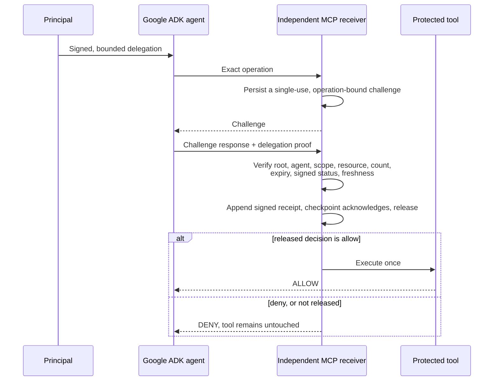
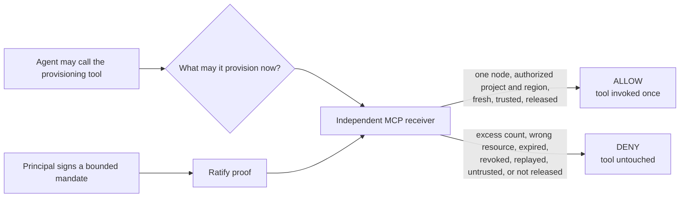

# Proof-carrying authority for Google ADK agents

**Status:** independent draft reference implementation. Not a Google
partnership, Google-approved integration, or Google reference architecture.

- **Protocol line:** v2 (2.0.0-beta.1)
- **Tested against:** the in-tree Python v2 SDK (`ratify-protocol-v2` and
  `ratify-protocol-native-v2` 2.0.0b1, built from this repository) until
  2.0.0-beta.1 is published. The deterministic gate is 58/58 green; see
  [`evidence/reference-evidence.md`](evidence/reference-evidence.md).
- **Protocol v1 history:** the v1 version of this reference (Ratify
  `1.0.0a20`, 49/49 gate, one-million-call endurance run) is kept unchanged in
  [`v1/`](v1/README.md).

This reference answers one narrow question:

> When a Google ADK agent crosses an MCP, A2A, tool, or organizational
> boundary, can the system carrying the consequence independently verify who
> authorized the agent for that exact action and which bounds still apply?

The visible result is intentionally simple:

```text
ALLOW -> tool invoked once
DENY  -> tool invocation count does not change
```

Identity answers **which workload connected**. ADK answers **how the agent
selected and called a tool**. Ratify answers a different question: **which
principal authorized this agent to perform this exact operation, on this
resource, within these signed limits?** The receiver verifies that evidence
locally, without sharing the sender's API key or calling the sender during the
decision.



The model may request more authority. It cannot grant that authority to
itself.

For the three-agent, cross-domain topology, the dual-root composition profile,
the status model, and the measured call tiers, see
[`FEDERATION_SCALE.md`](FEDERATION_SCALE.md).

## Why would a developer or enterprise need this?

Google Cloud and ADK already provide substantial controls: IAM on the resource,
service identity for the workload, and ADK's own tool and callback surface for
what an agent may select. Ratify is complementary. It gives the system carrying
the consequence evidence of the narrower mandate behind one action.

| Question | Google Cloud / ADK controls | Ratify authority |
| --- | --- | --- |
| Can this workload reach the API? | Yes, through IAM and service identity | Not its purpose |
| Can this agent select this tool? | Yes, through ADK tool configuration | Not its purpose |
| Did a recognized principal authorize this exact action? | Not expressed by workload identity alone | Yes |
| Is the authority limited to this project, region, and node count? | IAM can bound the resource; the per-action ceiling is application logic | Signed into the delegation and checked by the receiver |
| Can a different organization verify the mandate? | Depends on a shared Google Cloud trust domain | Yes, from portable proof and configured trust roots |
| Was the proof changed, revoked, expired, or replayed? | Separate concern | Verified before the handler runs |

Workload identity answers which service is calling. It does not carry which
human or organization sanctioned this particular provisioning request, at this
size, for this project. That distinction matters when an agent holds
credentials broader than the current task, when a receiver serves agents it did
not issue, or when the call crosses an organizational boundary.



## Who implements what

Four roles. The supported lane uses ADK's public agent, `FunctionTool`, and
`before_tool_callback` surfaces and an ordinary MCP receiver, so it requires no
change to Gemini or a Google Cloud service. A native `McpTool` integration would
benefit from a supported ADK hook for per-invocation MCP metadata.

| Role | Who this usually is | What they do | What they build |
| --- | --- | --- | --- |
| **Principal** | The organization accountable for the cloud resource | Signs a bounded delegation naming scope, resource, node count, and expiry; signs its revocation status under a separate status key | No protocol code. Issues delegations with the SDK and runs a status publisher (one signed list per issuer) |
| **Agent operator** | The team running the ADK agent | Points the agent at the receiver | No protocol code, but real configuration: receiver address, the agent's key and delegation chain, and which tools are protected |
| **Receiver operator** | Whoever owns the consequence: the provisioning API or MCP server | Issues challenges, verifies the proof, publishes receipts, releases decisions, guards the handler | The verification path: `authority_reference/receiver.py` and the transport boundary in `mcp_server.py`. The verify call is a small part; the rest is challenge issuance, trust-root pinning, ingesting signed status into the security journal, receipt publication and release, and keeping the handler unreachable except through a released allow. A production receiver also supplies durable claim, receipt, checkpoint and journal stores |
| **Google ADK / Gemini** | The agent framework and model | Select and call the tool as they already do | **Nothing** |

The asymmetry is the point. The party carrying the risk is the party that
checks, and it can check without trusting the agent, the model, the prompt, or
the framework that routed the call.

## Which path should I use?

**Use this open reference** when you want to read every line of the decision
path, run it without a Google Cloud account or a model key, and adapt the
receiver to your own service. It is Apache-2.0 with no runtime dependency on a
hosted Ratify service.

[Register interest in Ratify Verify](https://ratifyprotocol.com/?intent=proof#partners)
when you would rather not operate trust distribution, status freshness,
challenge and claim storage, the receipt log, and audit retention yourself.
Those are the deployment concerns under "Reference scope and production
requirements" below, and they are what turns a working reference into a
production control.

Both verify the same proofs. The protocol does not change between them.

## Run the gate

You need Bash, Python 3.10 or later (the recorded run used 3.12.10), a Rust
toolchain (the gate builds the v2 native signing extension with `maturin`),
and network access to install the pinned packages. You do not need a Google API
key or Google Cloud project.

From the Ratify repository root:

```bash
./references/google-adk/run-reference-check.sh
```

The script creates an isolated virtual environment (`references/google-adk/.venv`,
or `RATIFY_REFERENCE_VENV`), builds `ratify-protocol-native-v2` and installs
`ratify-protocol-v2` from this repository, installs the pinned platform
packages in `requirements.txt`, refuses to run if the SDK resolves from the
source tree or if the v1 `ratify_protocol` package is present, runs the
deterministic adversarial suite, and then runs the dual-root HTTP MCP
demonstration. It requires exactly 58 passing tests and fails if any test is
skipped, xfail, missing, or unexpectedly added.

**Release pin.** The SDK dependency moves to the published
`ratify-protocol-v2` and `ratify-protocol-native-v2` 2.0.0b1 (2.0.0-beta.1)
when they are released; the lines to change are marked `RATIFY_V2_PIN` in
`requirements.txt` and `run-reference-check.sh`. The 58/58 result has not yet
been reproduced against the published packages.

Tested pins:

- `google-adk==2.6.3`
- `mcp==1.29.0`
- `pytest==9.0.3`
- `ratify-protocol-v2` and `ratify-protocol-native-v2` 2.0.0b1 (in-tree build)

The deterministic path needs no API key, Google Cloud project, or paid
service. It drives the real ADK runner with a scripted model double, so ADK
still performs model-turn handling, tool selection, tool execution, and
function-response delivery. The authorization result cannot depend on model
judgment. The recorded run is in
[`evidence/reference-evidence.md`](evidence/reference-evidence.md).

Run the measured local authority path separately:

```bash
cd references/google-adk
source .venv/bin/activate
python -m authority_reference.scale_benchmark \
  --calls 10,100,1000 \
  --workers 8 \
  --output evidence/federation-scale-local-rerun.json
```

The rerun path uses a separate output name so it cannot overwrite the
checked-in evidence. The benchmark does not substitute extrapolated calls for
measured calls. The v1 one-million-call tier has not been repeated on v2; see
[`FEDERATION_SCALE.md`](FEDERATION_SCALE.md#measured-call-tiers) for why.

## What the reference implements

```text
Principal (root A)
  signs root -> ADK commander
        scope: custom:infra:provision + identity:delegate
                  |
                  v
ADK commander
  signs commander -> infrastructure specialist
        scope:       custom:infra:provision            (one exact custom scope)
        resource:    gcp:projects/customer-project/regions/us-central1
        constraint:  com.ratifyprotocol.max_count      {"counter":"nodes","max":1}
                  |
                  v
Google ADK public callback + FunctionTool
  exposes only ordinary business arguments to the model
  obtains an operation-bound challenge after tool selection
  signs it with the specialist key
  carries the proof in MCP request metadata
                  |
                  v
Independent Streamable HTTP MCP receiver
  pins the complete root public key out of band
  reconstructs the operation, request hash and session context
  issues the challenge through the SDK helper, which persists it first
  ingests each issuer's signed status list into its security journal
  verifies chain signatures, scope, resource, node count, expiry and status
  appends a signed receipt; the checkpoint acknowledges it; releases
  invokes the protected tool only for a released allow
```

The node ceiling uses the standard extension evaluator profile
`com.ratifyprotocol.max_count/v1` (SPEC-v2 §5.2). The receiver registers that
profile explicitly and supplies the requested node count as
`extension_counts["nodes"]` from the authenticated request, never from the
proof. The profile's digest is signed into every receipt for the claim. A
verifier that has not registered the profile cannot pass the constraint.

### What changed from the v1 reference

| v1 (`1.0.0a20`) | v2 (this reference) |
| --- | --- |
| `custom:infra:provision` matched by the v1 custom-scope rules | One exact custom scope, matched by byte equality; `custom:*` is refused at issuance |
| `com.ratifyprotocol.adk.max_nodes`, a reference-specific evaluator | Standard `com.ratifyprotocol.max_count/v1` profile with `extension_counts` |
| Unsigned in-process revocation set or snapshot with a staleness budget | Each issuer signs a revocation list with a separate status key through the SDK status publisher; the receiver authenticates it into its security journal |
| Receiver-generated challenge in a memory store | SDK issuance helper persists the challenge before returning it |
| `verify_bundle` returns valid, the handler runs | Verification commits a decision, the signed receipt is appended and acknowledged, and only the released decision can reach the handler |
| Dual root: two bundles on one challenge, authority plus admission scope | SPEC-v2 §7.14 dual-root composition profile: one approval set, two challenges, two released allows, an application ledger that executes once |
| Verifier ID derived from the receiver key with a text prefix | The 64-hex v2 key ID of the receiver's receipt-signing key |

## Code map

Start with these files if you want to inspect or adapt the reference:

| File | Responsibility |
|---|---|
| [`authority_reference/authority.py`](authority_reference/authority.py) | Issues the principal-to-commander and commander-to-specialist delegations, the federation chain, and the second root's approval |
| [`authority_reference/status_feed.py`](authority_reference/status_feed.py) | One status publisher per issuer under a separate status key, and the file-based local status feed |
| [`authority_reference/adk_mcp.py`](authority_reference/adk_mcp.py) | Keeps the model-facing schema ordinary, then obtains a challenge and injects the proof after ADK selects the tool |
| [`authority_reference/multi_agent.py`](authority_reference/multi_agent.py) | Builds the ADK coordinator, broker, and worker routing topology |
| [`authority_reference/receiver.py`](authority_reference/receiver.py) | Reconstructs the operation, verifies, publishes, releases, runs the approval ledger, and gates the protected handler |
| [`authority_reference/scale_benchmark.py`](authority_reference/scale_benchmark.py) | Runs exact full-path call tiers and emits machine-readable measurements |
| [`authority_reference/mcp_server.py`](authority_reference/mcp_server.py) | Exposes the receiver through authenticated Streamable HTTP MCP |
| [`authority_reference/deployment_config.py`](authority_reference/deployment_config.py) | Writes separate receiver and presenter configuration with mode `0600` and publishes the status feed |
| [`tests/test_reference.py`](tests/test_reference.py) | Exercises the ADK runner, MCP boundary, trust-root attacks, replay, signed status, release, the dual-root profile, malformed input, concurrency, and availability behavior |

When adapting this profile to another tool, keep the receiver in control of
the trust root, operation construction, challenge issuance, status ingestion,
and final policy decision. Bind the proof to the exact operation and receiving
context. Call the protected handler only for a released allow that is still
allowed at the receiver's clock. Keys and proof bytes should stay outside model
context.

## Layer separation

| Layer | Question answered | This reference does not claim |
|---|---|---|
| Google Agent Identity / IAM | Which deployed agent workload is calling, and which Google Cloud permissions does it have? | That the workload carries a principal-signed grant for this exact cross-boundary action |
| Google ADK | How does the agent reason and invoke a tool? | That MCP transport alone proves delegated authority |
| MCP / A2A / tool transport | How does the request cross the boundary? | That transport authentication proves the principal's bounded intent |
| Ratify | Who delegated authority, for which scope/resource/bounds, and is the presentation fresh and unrevoked? | That the receiver must execute |
| Receiver policy and tool | Is the verified request acceptable now, and should the action execute? | That verifier-supplied context becomes trustworthy without receiver validation |

## Security boundary

The receiver is the security boundary. It performs six actions the presenting
agent is not trusted to perform:

1. Pins the complete root public key. A valid self-issued chain is denied.
2. Parses and validates the requested operation.
3. Constructs the operation hash and session context itself.
4. Issues each challenge through the SDK helper, which persists it before it
   is returned, and lets the claim store consume it exactly once.
5. Accepts revocation status only when it is signed by the issuer's configured
   status key, which must be distinct from every delegation key.
6. Runs the handler only for a released decision: the signed receipt is in the
   log, the checkpoint has acknowledged it, and the allow is still current.

The ADK tool is presentation code. It injects the proof so the model never sees
private keys or proof bytes. Moving verification into an ADK callback inside
the agent process would be a useful fail-fast check, but not a security
control: a compromised agent could skip its own callback.

## What the reference proves

The suite encodes why the boundary matters:

| Case | Expected result | Protected tool |
|---|---|---|
| Correct agent, one node, `us-central1` | released `allow`, one signed receipt | Invoked once |
| Three nodes under a one-node grant | `constraint_denied` (max_count profile) | Not invoked |
| `us-east1` under a `us-central1` grant | `constraint_denied` (`resource_path`) | Not invoked |
| Expired delegation | `delegation_expired` | Not invoked |
| Leaf or intermediate revoked by a signed status list | `delegation_revoked` | Not invoked |
| Status signed by a key the receiver did not configure | `status_unavailable` | Not invoked |
| Status list past its `next_update` with no heartbeat | `status_stale` | Not invoked |
| Status key equal to an issuer key | Receiver configuration refused | Not reached |
| Checkpoint does not acknowledge the receipt | Not released | Not invoked |
| Replayed presentation, even with the application envelope restored | Claim replay | Not invoked again |
| Operation changed after challenge issuance | `operation_binding_failed` | Not invoked |
| Different agent answers the challenge | `agent_binding_failed` | Not invoked |
| Valid chain under an untrusted root | `untrusted_root` | Not invoked |
| `custom:*` in a certificate | Refused at issuance | Not reached |
| Dual root: both roots approve | Two released allows, ledger executes once | Invoked once |
| Dual root: second approval missing, revoked, on the wrong challenge, or naming the same root twice | Denied or refused | Not invoked |
| Non-integral, zero, negative, boolean, or excessive node count | Input rejected | Not invoked |
| Duplicate transport-authentication headers | HTTP `400` before MCP dispatch | Not invoked |

## Optional live Gemini path

The deterministic suite is authoritative. To let Gemini select and invoke the
same ADK tool interactively, run the gate above first. It creates the `.venv`
used below. Then run:

```bash
cd references/google-adk
source .venv/bin/activate
python bootstrap_live.py
python -m authority_reference.mcp_server \
  --trust-config .local/receiver-trust.json --port 8765
```

`bootstrap_live.py` creates `.local/receiver-trust.json` and
`.local/presenter.json`, both secret-bearing and written with mode `0600`, and
publishes each issuer's signed status list to `.local/status`. The lists are
signed for 24 hours; after that the receiver denies with `status_stale`.
Remove `.local/` before generating a new authority.

In a second shell:

```bash
cd references/google-adk
source .venv/bin/activate
export GOOGLE_API_KEY=your_key
export RATIFY_PRESENTER_CONFIG=.local/presenter.json
export RATIFY_MCP_RECEIVER_URL=http://127.0.0.1:8765/mcp
adk run adk_app
```

Example prompt:

```text
Provision one n2-standard-4 node in us-central1. Use request id demo-1.
```

Then request three nodes or change the region and observe the receiver denial.
The app is configured with `gemini-3.6-flash` as an example Flash model; verify
that model identifier against the ADK and Gemini release available to your
project before running. The optional live path demonstrates orchestration; it
adds no authorization guarantee beyond the deterministic receiver tests, and it
was not run for the recorded v2 evidence.

## Evidence tiers

| Tier | Executed here | Meaning |
|---|---|---|
| Receiver verification and release | Yes | Cryptographic, status and local-policy allow/deny matrix with signed receipts |
| ADK `FunctionTool` | Yes | Baseline in-process composition |
| Native ADK `McpToolset` | Yes | Ordinary schema; hidden proof injection; independent HTTP receiver |
| Public ADK callback + MCP metadata | Yes | Supported hook; proof captured in `_meta` and absent from ADK events |
| Three-agent ADK handoff | Yes | Coordinator to broker to worker reaches the federated receiver gate |
| Dual-root composition profile | Yes | Two challenges, two released approvals, ledger executes once |
| Signed status over a local feed | Yes | A revocation written to the feed denies the next HTTP call |
| Exact-call scale | 10, 100, and 1,000 calls measured locally | Full dual-root path; see `FEDERATION_SCALE.md` |
| ADK runner loop | Yes | Model turn → MCP function call → gated receiver → function response |
| Gemini 3.6 Flash | Configuration-ready | Requires an operator API key; not part of recorded evidence |
| A2A / Agent Engine | Not yet | Proposed follow-on, not claimed as executed |

## Reference scope and production requirements

- **Development-only stores.** The claim store, receipt log, checkpoint,
  challenge issuance store, security journal and approval ledger are the SDK's
  in-memory reference stores (`ratify_protocol_v2.v2reference`). They are not
  durable, do not span processes, and the checkpoint is not independent of the
  receiver. A production receiver supplies durable Part B stores and an
  independent checkpoint (SPEC-v2 §7). No production claim is made here.
- **Status needs a feed.** A v2 allow requires current signed status for every
  certificate in the chain. Verification makes no call to Ratify
  infrastructure on the synchronous path, but only because the receiver holds
  its own local status feed, claim store, receipt log and checkpoint. Here the
  feed is a directory of signed lists; a production deployment distributes and
  heartbeats them.
- **Status publisher state is in memory.** A production issuer persists the
  next publisher state before it publishes the signed objects.
- The default protected provisioner is in memory. The tests also use the
  included SQLite provisioner to prove a durable receiver-owned write exists
  only after allow. No Google Cloud resources are created.
- Trust-root distribution, key custody, rate limits, and production audit
  retention are deployment responsibilities not solved by this draft.
- The logical `gcp:` resource name is an integration profile. Verification
  proves authorization against the receiver-supplied logical resource; the
  execution layer must still ensure the real cloud operation matches it.
- This reference composes with Agent Identity conceptually but does not deploy
  to Vertex AI Agent Engine or exercise preview IAM Agent Identity APIs.
- The recommended lane uses public `before_tool_callback` and `FunctionTool`
  APIs. A separate native `McpToolset` compatibility lane still uses a small
  pinned-version adapter because ADK does not expose operation-specific custom
  MCP metadata on `McpTool`; that gap should be reviewed with the ADK team.
- The internal challenge tool remains MCP-discoverable to authenticated clients
  but is excluded from the model toolset. Authentication, bounded receiver
  state, and receiver verification, not client-side hiding, are the controls.
- This is deliberately one concrete infrastructure-tool profile, not a claim
  that arbitrary MCP schemas can be wrapped without an explicit authority map.
- Dependencies are version-pinned but not installed with artifact hashes, and
  the v2 SDK is built from this repository until 2.0.0-beta.1 is published.
- The local profile uses one static transport token. Any holder can consume the
  bounded 128-operation pending capacity until its five-minute TTL expires;
  production deployments need per-workload authentication and rate limits.
- Protected execution is at-most-once, not exactly-once. If the response is
  lost after execution, replay is denied; a production tool needs an
  idempotency/result ledger before an operator retries the business action.
- The Python v2 verifier is much slower than the v1 package that produced the
  one-million-call run. The checked-in tiers in `FEDERATION_SCALE.md`, run on
  the in-tree `2.0.0b1` SDK with hybrid verification in the native extension,
  measured 15.2 / 16.2 / 15.7 calls/s for 10 / 100 / 1,000 dual-root calls on
  one host; see
  [`sdks/python-v2/README.md`](../../sdks/python-v2/README.md#performance).
- The executed draft uses the real ADK runner and native `McpToolset` across an
  independently started Streamable HTTP MCP receiver with receiver-owned trust
  configuration. It does not yet execute A2A, TLS workload authentication,
  Agent Engine, or Agent Identity deployment.

## Sources

- Google Agent Identity: <https://docs.cloud.google.com/iam/docs/auth-agent-own-identity>
- Google ADK: <https://github.com/google/adk-python>
- ADK MCP tools: <https://google.github.io/adk-docs/tools-custom/mcp-tools/>
- Gemini API release notes: <https://ai.google.dev/gemini-api/docs/changelog>
- Ratify Protocol: <https://github.com/identities-ai/ratify-protocol>
- Ratify Protocol v2 specification: [`SPEC-v2.md`](../../SPEC-v2.md)
- Agent Relay integration note: <https://ratifyprotocol.com/writing/agent-relay-phase1-technical-note>
