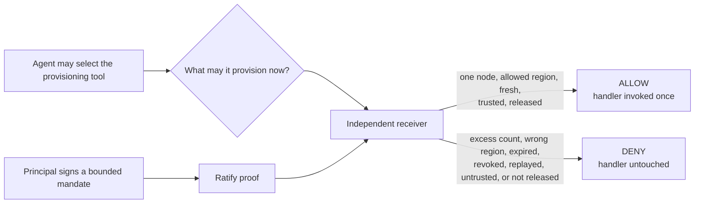
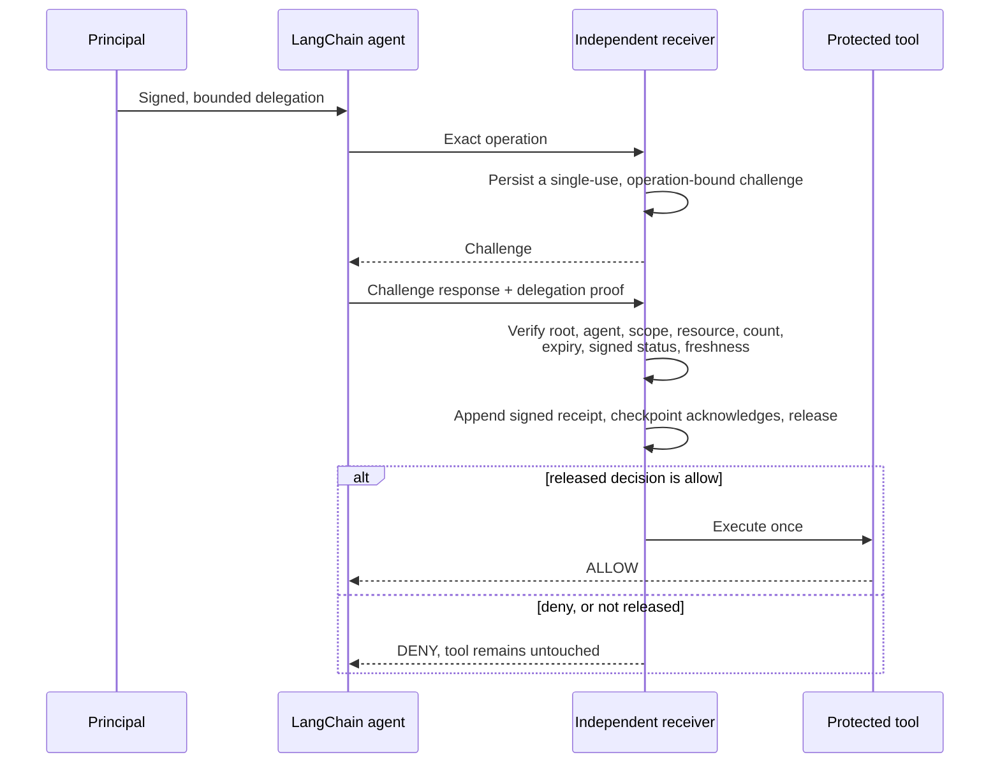

# Proof-carrying authority for LangChain agents

**Status:** independent draft reference implementation. Not a LangChain
partnership, LangChain-approved integration, or LangChain reference architecture.

- **Protocol line:** v2 (2.0.0-beta.1)
- **Tested against:** the in-tree Python v2 SDK (`ratify-protocol-v2` and
  `ratify-protocol-native-v2` 2.0.0b1, built from this repository) until
  2.0.0-beta.1 is published. The deterministic gate is 34/34 green; see
  [`evidence/reference-evidence.md`](evidence/reference-evidence.md).
- **Protocol v1 history:** the v1 version of this reference (Ratify
  `1.0.0a19`, 28/28 gate) is kept unchanged in [`v1/`](v1/README.md).

This reference answers one narrow question:

> When a LangChain agent crosses an MCP or organizational boundary, can the
> receiver independently verify who authorized that agent for the exact action
> and which bounds still apply?

## Why would a developer or enterprise need this?

LangChain and LangSmith already provide real controls: which agents run, which
tools they may select, which credentials they carry, and who may reach the Agent
Server. Ratify is complementary. It gives the system that carries the
consequence evidence of the narrower mandate behind one action.

| Question | LangChain / LangSmith controls | Ratify authority |
| --- | --- | --- |
| Can this agent select this tool? | Yes | Not its purpose |
| Does the agent hold a usable credential? | Yes | Not its purpose |
| Did a recognized principal authorize this exact action? | Not expressed by tool access alone | Yes |
| Is the authority limited to this region, size, and count? | Application logic may check | Signed into the delegation and checked by the receiver |
| Can a different organization verify the mandate? | Depends on shared platform and credentials | Yes, from portable proof and configured trust roots |
| Was the proof changed, revoked, expired, or replayed? | Separate concern | Verified before the handler runs |

This matters when a LangChain agent holds credentials broader than the current
task, when an MCP or SaaS provider receives calls from agents it did not issue,
when agents cross an organizational boundary, or when an audit has to answer who
authorized what, for which agent, resource, and time window.



## Optional Jev decision adapter

The reference includes an optional adapter for [Jev](https://typesafe.ai/blog/introducing-system-one-models-and-jev),
TypeSafe's typed-decision model. The adapter sends the agent state and available
tool descriptions to the documented TypeSafe API and receives a selected tool,
probabilities, and confidence. LangChain can then expose the selected tool to
the agent loop.

Jev only proposes the tool. It does not create, carry, or verify Ratify
authority. The MCP interceptor still attaches the proof, and the receiver still
runs the Ratify verifier before the protected handler can execute.

The offline gate uses a deterministic Jev stub, so it needs no hosted-model API
key. To use the real adapter, install no additional package, set
`TYPESAFE_API_KEY`, and call `JevClient` from
`authority_reference/jev_adapter.py`. The adapter uses
`https://api.typesafe.ai/v1/systemone` and the `jev-latest` model by default.

Coding agents are a natural application of this boundary. Jev can propose a
bounded tool such as a repository search, patch, or allowlisted test command;
local application policy can request approval; and the receiver can verify
authority before a mutation runs. This reference demonstrates bounded tool
selection and receiver verification. It does not claim arbitrary shell access,
filesystem mutation, deployment control, dynamic context selection, or
security-aware model routing.

## Who implements what

Four roles. **LangChain implements nothing**: the reference uses the public
`MultiServerMCPClient` tool-interceptor API and the standard `create_agent`
loop, so no change to LangChain, LangGraph, or LangSmith is required.

| Role | Who this usually is | What they do | What they build |
| --- | --- | --- | --- |
| **Principal** | The organization accountable for the resource | Signs a bounded delegation naming scope, region, count, and expiry; signs its revocation status under a separate status key | No protocol code. Issues delegations with the SDK and runs a status publisher (one signed list per issuer) |
| **Agent operator** | The team running the LangChain agent | Adds the interceptor and points it at the receiver | No protocol code, but real configuration: receiver address, the agent's key and delegation chain, and which tools are protected |
| **Receiver operator** | Whoever owns the consequence: the provisioning API, the MCP server | Issues challenges, verifies the proof, publishes receipts, releases decisions, guards the handler | The verification path. Here `authority_reference/receiver.py` plus the HTTP boundary in `mcp_server.py`: the verify call is a small part, and the rest is challenge issuance, header bounds, trust-root pinning, ingesting signed status, receipt publication and release, and keeping the handler unreachable except through a released allow. A production receiver also supplies durable claim, receipt, checkpoint and journal stores |
| **LangChain / LangGraph** | The agent framework | Selects and calls the tool as it already does | **Nothing** |

The asymmetry is the point. The party carrying the risk is the party that
checks, and it can check without trusting the agent, the model, the prompt, or
the framework that routed the call.

```text
ALLOW -> protected tool invoked once
DENY  -> protected tool invocation count does not change
```

Identity answers **which workload connected**. LangChain answers **which tool
the agent selected**. Ratify answers a different question: **which principal
authorized this agent to perform this exact operation, on this resource, within
these signed limits?** The receiving organization verifies that evidence
locally, without sharing the sender's API key or calling the sender during the
decision.



## Run the gate

You need Bash, Python 3.10 or later (the recorded run used 3.12.10), a Rust
toolchain (the gate builds the v2 native signing extension with `maturin`),
and network access to install the pinned packages. From the repository root:

```bash
./references/langchain/run-reference-check.sh
```

The gate creates a clean virtual environment (`references/langchain/.venv`,
or `RATIFY_REFERENCE_VENV`), builds `ratify-protocol-native-v2` and installs
`ratify-protocol-v2` from this repository, installs the pinned platform
packages, refuses to run if the SDK resolves from the source tree or if the v1
`ratify_protocol` package is present, and uses the real `create_agent`
LangGraph loop with a deterministic model double, the public
`MultiServerMCPClient` tool-interceptor API, and an independently started
Streamable HTTP MCP receiver. It needs no model API key or paid service. It
requires exactly 33 passing tests and fails on a skipped, xfail, missing, or
additional test. See [`evidence/reference-evidence.md`](evidence/reference-evidence.md).

**Release pin.** The SDK dependency moves to the published
`ratify-protocol-v2` and `ratify-protocol-native-v2` 2.0.0b1 (2.0.0-beta.1)
when they are released; the lines to change are marked `RATIFY_V2_PIN` in
`requirements.txt` and `run-reference-check.sh`. The 34/34 result has not yet
been reproduced against the published packages.

## Boundary

The model sees only `request_id`, `region`, `instance_type`, and `count`. After
tool selection, a LangChain MCP interceptor obtains an operation-bound challenge,
signs it outside model context, and adds the proof as a per-call HTTP header.
The agent-side example can apply a local preflight to the visible delegation
bounds, but that check has no receiver-owned status view and does not consume
the challenge. The receiver pins the complete root key and the expected agent
key out of band, reconstructs the operation, verifies the delegation at
execution time against signed status in its own journal, publishes a signed
receipt, and invokes the protected handler only for a released allow.

```text
Principal (root)
  signs root -> LangChain commander
        scope: custom:infra:provision + identity:delegate
                  |
                  v
LangChain commander
  signs commander -> infrastructure specialist
        scope:       custom:infra:provision            (one exact custom scope)
        resource:    gcp:projects/customer-project/regions/us-central1
        constraint:  com.ratifyprotocol.max_count      {"counter":"nodes","max":1}
```

The node ceiling uses the standard extension evaluator profile
`com.ratifyprotocol.max_count/v1` (SPEC-v2 §5.2). The receiver registers that
profile and supplies the requested node count as `extension_counts["nodes"]`
from the authenticated request, never from the proof.

LangChain and LangGraph orchestrate the agent. LangSmith authentication and
authorization protect Agent Server resources and can supply user-scoped
credentials. MCP transports the tool call. Ratify adds portable evidence of the
principal's bounded authority for the exact action. Receiver policy still makes
the final execution decision.

### What changed from the v1 reference

| v1 (`1.0.0a19`) | v2 (this reference) |
| --- | --- |
| `com.ratifyprotocol.langchain.max_nodes`, a reference-specific evaluator | Standard `com.ratifyprotocol.max_count/v1` profile with `extension_counts` |
| Static in-process revocation set | Each issuer signs a revocation list with a separate status key through the SDK status publisher; the receiver authenticates it into its security journal |
| Receiver-generated challenge in a memory store | SDK issuance helper persists the challenge before returning it |
| `verify_bundle` returns valid, the handler runs | Verification commits a decision, the signed receipt is appended and acknowledged, and only the released decision can reach the handler |
| Fixed text verifier ID | The 64-hex v2 key ID of the receiver's receipt-signing key |
| `custom:infra:provision` under the v1 custom-scope rules | One exact custom scope, matched by byte equality |

## What the reference proves

| Boundary case | Expected effect |
|---|---|
| Valid two-hop delegation, one node, allowed region | Released allow with a signed receipt; handler invoked once |
| Excess count or wrong region | Signed constraint denies before execution |
| Expired or revoked delegation | Denied before execution |
| Authority revoked or expired between local preflight and execution | Receiver rechecks current signed status and expiry, and denies before execution |
| Status signed by an unconfigured key, or past `next_update` without a heartbeat | `status_unavailable` or `status_stale`; denied |
| Status key equal to the root key | Receiver configuration refused |
| Checkpoint does not acknowledge the receipt | Not released; handler not invoked |
| Replayed proof, even with the application envelope restored, or changed operation | Denied; prior execution count is unchanged |
| Wrong presenting agent or untrusted root | Denied despite a cryptographically valid hostile proof |
| Malformed proof or invalid business input | Denied without consuming honest work or reaching the tool |
| Signed revocation written to the local status feed | The next HTTP call is denied |
| Duplicate transport/proof headers or oversized proof header | HTTP boundary rejects the request before MCP |
| Missing transport credential | HTTP `401`; MCP receiver is not reached |
| Concurrent duplicate request IDs or exhausted pending capacity | Receiver state remains bounded and unambiguous |
| Real `create_agent` → interceptor → HTTP MCP path | Proof stays out of the model schema and ALLOW reaches the tool |

The deterministic model is deliberate: authorization must not depend on a
model deciding to follow a security instruction. A live model would demonstrate
tool selection, but add no authority guarantee.

## Tested pins

- `langchain==1.3.14`
- `langchain-mcp-adapters==0.3.0`
- `mcp==1.29.0`
- `pytest==9.0.3`
- `pytest-asyncio==1.4.0`
- `ratify-protocol-v2` and `ratify-protocol-native-v2` 2.0.0b1 (in-tree build)

## Which path should I use?

**Use this open reference** when you want to read every line of the decision
path, run it with no account, and adapt the receiver to your own service. It is
Apache-2.0 and has no runtime dependency on any hosted Ratify service.

[Register interest in Ratify Verify](https://ratifyprotocol.com/?intent=proof#partners)
when you would rather not operate trust distribution, status freshness,
challenge and claim storage, the receipt log, and audit retention yourself.
Those are the deployment concerns listed under Limitations below, and they are
the parts that turn a working reference into a production control.

Both verify the same proofs. The protocol does not change between them.

## Repository map

| Path | Purpose |
| --- | --- |
| `authority_reference/langchain_agent.py` | The agent and the MCP tool interceptor that carries the proof |
| `authority_reference/jev_adapter.py` | Optional Jev tool-selection adapter; proposal only |
| `authority_reference/mcp_server.py` | HTTP boundary: transport credential, header bounds, duplicate rejection |
| `authority_reference/receiver.py` | Verification, receipt publication, release, and the protected handler boundary |
| `authority_reference/status_feed.py` | One status publisher per issuer under a separate status key, and the file-based local status feed |
| `authority_reference/authority.py` | Reference identities and the bounded delegation |
| `authority_reference/deployment_config.py` | Trust root, expected agent, status keys and the receiver's verifier key, pinned out of band |
| `tests/test_reference.py` | The 33 deterministic boundary, status, release, and Jev-separation cases |
| `evidence/reference-evidence.md` | Executed evidence for the gate |
| `DESIGN.md` | Architecture and threat-boundary rationale |
| `v1/` | The Protocol v1 reference and its evidence, kept as dated history |

## Limitations

- **Development-only stores.** The claim store, receipt log, checkpoint,
  challenge issuance store and security journal are the SDK's in-memory
  reference stores (`ratify_protocol_v2.v2reference`). They are not durable,
  fail closed on restart, and the checkpoint is not independent of the
  receiver. A production receiver supplies durable Part B stores and an
  independent checkpoint (SPEC-v2 §7).
- **Status needs a feed.** A v2 allow requires current signed status for every
  certificate in the chain. Here the feed is a directory of signed lists and
  the publisher state is in memory; a production issuer persists publisher
  state, and the deployment distributes and heartbeats the lists.
- The protected provisioner is a counter; no cloud resources are created.
- Loopback HTTP is used without TLS or production workload identity.
- Trust distribution, rate limits, key custody, and audit retention remain
  deployment concerns.
- Proof headers are an independent integration profile, not an MCP or LangChain
  standard. The two-certificate v2 presentation is 28,408 bytes on the wire and
  37,880 bytes as the base64 header value. This reference rejects
  presentations over 64 KiB, but many production proxies default to a much
  smaller per-header limit. Do not deploy this carrier without aligning every
  hop's limits and log redaction. A standardized MCP metadata or body carrier
  is the preferred maintainer-reviewed production path, especially for deeper
  post-quantum chains.
- Execution is at-most-once, not exactly-once; production retries require an
  idempotency and result ledger.
- LangSmith deployment, Agent Server custom auth, durable checkpoints, and live
  hosted models are composition-ready but not exercised or claimed here.

See [DESIGN.md](DESIGN.md) for the architecture and threat-boundary rationale.
