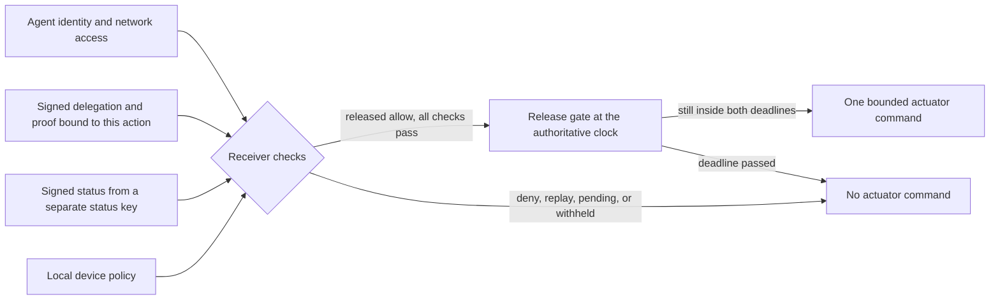
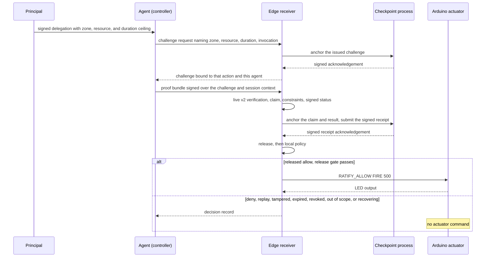

# Ratify Edge Physical AI

**Verify delegated authority at a Linux edge boundary before a bounded physical actuation.**

[Ratify Protocol](https://ratifyprotocol.com) is an open protocol for proving delegated authority. A principal signs a bounded delegation naming what an agent may do, and any receiver can verify that proof offline, before acting, without calling the issuer. Signatures are hybrid Ed25519 and ML-DSA-65.

This experimental reference runs Ratify Protocol v2 (`2.0.0-beta.1`, a prerelease) through the C ABI on a Linux receiver, with a separate checkpoint process, in front of a safe Arduino actuator. It is self-authored by the Ratify Protocol project. It is not a platform partnership, endorsed integration, or safety-certified reference architecture. Protocol v2 has had only the project's own pre-release security review and carries no production security claim yet.

**Start here:** [run it](#use-it-now) · [evidence and limitations](#evidence-security-status-and-limitations) · [open source or Ratify Verify](#which-path-should-i-use)

## Why would a developer or enterprise need this?

Robots, farm equipment, instruments, and edge devices need to decide whether an action is authorized at the point where it has consequences. Network identity and agent-framework permissions are useful controls, but they do not by themselves express which principal approved this exact action, resource, duration, and time window.

| Question | Network and platform controls | Ratify authority |
| --- | --- | --- |
| Can this process reach the receiver? | Usually yes | Not its purpose |
| Did a recognized principal authorize this action? | Not expressed by reachability alone | Signed delegation is checked |
| Is the requested zone, resource, and duration within bounds? | Often application-specific | Signed constraints, then local policy |
| Can the decision be checked without a network call? | Depends on deployment | Yes, with staged signed status |
| Is there a signed record before anything moves? | Usually not | A signed receipt, acknowledged by a separate process, before release |



This matters when an agent can call a tool but must not have unlimited authority: agricultural equipment, warehouse robots, drones, laboratory instruments, charging systems, and other edge-controlled devices. Ratify complements IAM, OAuth, MCP, A2A, and local policy; it does not replace them.

## Who implements what

| Role | What it decides or builds | This reference uses |
| --- | --- | --- |
| Principal | Sets the authority ceiling, signs the delegation, and publishes signed status with a separate status key | `controller/controller.c` with demonstration keys in files |
| Agent operator | Requests a challenge for one action and presents the proof | `controller/controller.c`; the Google ADK adapter in `adk/` targets the v1 receiver and has not been ported |
| Receiver operator | Pins the root, status, agent, and checkpoint keys, sets local policy, runs the receiver and the checkpoint, maps the actuator | `edge/` (about 4,000 lines of C, most of it the durable stores, the checkpoint, and small SHA-2 and base64 helpers; the verification itself is library calls) |
| Actuator operator | Connects and programs the safe output device | Arduino sketch in `arduino/` |
| Platform vendor | No change required to its platform | Ratify is independent of an agent framework |

The receiver operator has real configuration to decide: the trusted root, the status freshness budget, the zone allowlist, the duration cap, the clock, and which user runs the checkpoint. The Arduino is an untrusted actuator, not the authorization boundary. It does not verify proofs, hold keys, enforce local policy, or provide trusted time. Direct access to the Arduino is outside this reference's security boundary.

## What does this reference do?

The example delegation authorizes a bounded farm action:

```text
scope        physical:actuate
constraint   resource_path  resource_id = greenhouse-b, path_prefix = /irrigation-valve-3
constraint   com.ratifyprotocol.max_count  duration_ms <= 20000 (standard max_count/v1 profile)
validity     signed issued_at and expires_at
local cap    zone greenhouse-b only, 1000 ms maximum (device policy)
```

Protocol v2.0 has no registered geofence or activation-duration constraint; both arrive no earlier than Protocol 2.1. The zone is therefore a lexical resource identifier checked by `resource_path`, not a location, and the duration ceiling is an extension constraint evaluated by the standard `max_count/v1` profile plus the device's own cap. The current hardware maps the valve action to a short LED command over USB serial. No hazardous device is connected.



The Linux receiver is the enforcement boundary. Only a released Protocol v2 allow for `physical:actuate`, within local policy, and confirmed by `ratify_v2_released_allowed` at the receiver's authoritative clock immediately before the write, can reach the actuator. The agent, model, transport, checkpoint, and Arduino cannot turn a refused decision into an actuation inside this reference.

The receiver verifies, publishes, and acts in one process. At restart it promotes an anchored state, recovers claims whose lease expired, and drains its own receipt outbox, so publication and checkpoint submission complete without a caller handoff (SPEC-v2 §7.11). It does not act on a decision whose request was lost in a crash; the requester must ask again with a fresh challenge. `edge/tests/crash.sh` exits the receiver's test build at each durable write and checks that no crash point fires the actuator twice or for a request that was not released.

## What the reference proves

The deterministic gate runs a 32-row scenario matrix against the test builds with a fixture clock and a mock actuator. It never writes to a serial device or GPIO line. Every row asserts the receiver's recorded stage and outcome and whether the actuator fired, and the run asserts the exact invocation count.

| Tested case | Receiver outcome | Actuator |
| --- | --- | --- |
| authorized `physical:actuate` | released allow | fired |
| authorized `infrastructure:monitor` | released allow | not fired |
| scope outside the delegation | released deny, `scope_denied` | not fired |
| zone outside the delegation | released deny, `constraint_denied` | not fired |
| duration above the signed ceiling | released deny, `constraint_denied` | not fired |
| duration above the local cap only | released allow, refused by local policy | not fired |
| altered challenge signature | refused before claim, `invalid_signature` | not fired |
| action changed after the challenge | refused before claim | not fired |
| chain from an untrusted root | released deny, `unauthorized` | not fired |
| first presentation of a captured proof | released allow | fired |
| same proof again | replay, nothing disclosed | not fired |
| challenge presented after expiry | refused before claim, `challenge_not_fresh` | not fired |
| certificate revoked by a signed push | released deny, `delegation_revoked` | not fired |
| delegation past its expiry | released deny, `delegation_expired` | not fired |
| replay after a receiver restart | replay (durable claim store) | not fired |
| actuation during post-boot quarantine | refused | not fired |
| clock moved backward | no challenge issued, `clock_regressed` | not fired |
| checkpoint stopped | no challenge issued | not fired |
| receiver state restored from an earlier copy | receiver stays recovering, refuses everything | not fired |
| root key reused as the status key | publisher and receiver both refuse | not applicable |

The full table, including the recovery rows, is in [`docs/evidence.md`](docs/evidence.md). The local gate result is **32 passed, 0 failed, 0 skipped**, with 5 actuator invocations in total, all to the mock.

## Use it now

Prerequisites: a C compiler, `make`, and a Ratify C SDK `2.0.0-beta.1` tree containing `include/ratify.h` and `lib/libratify_c.a`, built from `sdks/c` in this repository. The gate needs no Arduino, model API, cloud account, or RTC.

1. Clone the protocol repository and build the C SDK:

   ```sh
   git clone https://github.com/identities-ai/ratify-protocol
   cd ratify-protocol/sdks/c && cargo build --release && cd ../..
   mkdir -p /tmp/ratify-c/include /tmp/ratify-c/lib
   cp sdks/c/include/ratify.h /tmp/ratify-c/include/
   cp sdks/c/target/release/libratify_c.a /tmp/ratify-c/lib/
   ```

2. Run the gate from the reference directory:

   ```sh
   cd references/physical-ai-edge-sentinel
   RATIFY_SDK=/tmp/ratify-c ./run-reference-check.sh
   ```

3. For the Raspberry Pi 2 (ARMv7), cross-build the SDK and the binaries:

   ```sh
   cd sdks/c && cargo zigbuild --release --target armv7-unknown-linux-gnueabihf.2.36
   # then, with RATIFY_SDK pointing at the armv7 include and lib:
   make -C references/physical-ai-edge-sentinel/edge RATIFY_SDK=/path/to/ratify-c-armv7 \
     CC="zig cc -target arm-linux-gnueabihf.2.36 -mcpu=cortex_a7" UNAME_S=Linux all test-bins
   ```

   On the Pi, `BIN_DIR=/path/to/binaries ./edge/tests/scenarios.sh` runs the same matrix with the mock actuator.

4. The hardware path uses the production binaries, the DS3231 RTC, and the Arduino. Upload `arduino/ratify_actuator/ratify_actuator.ino`, initialize the checkpoint and the receiver, and start both:

   ```sh
   edge-checkpoint --init --dir ckpt
   edge-checkpoint --dir ckpt --socket ckpt.sock &
   edge --init --state state --trust trust --checkpoint ckpt.sock
   edge --state state --trust trust --checkpoint ckpt.sock --serial /dev/ttyACM0 --baud 115200
   ```

   The production receiver refuses to decide without the RTC and refuses actuation for 300 seconds after start. Run the checkpoint as a separate Unix user (`--allow-uid` names the receiver's user) so the receiver cannot read the checkpoint's key; see [`docs/v2-design.md`](docs/v2-design.md) for what that separation does and does not protect on a Pi.

## Which path should I use?

Use this open reference when you need inspectable source, a deterministic local gate, and a safe demonstration of the verification boundary. Use [Ratify Verify](https://ratifyprotocol.com/?intent=proof#partners) when you need managed trust configuration, revocation operations, audit retention, observability, availability, and supported deployment adapters.

## What is cryptographically bound?

- **Delegation certificate, signed by the root key:** the issuer and subject complete public keys and IDs, the scope, the `resource_path` constraint (zone and resource), the `max_count` duration ceiling, and the validity window.
- **Proof bundle, signed by the agent key:** the challenge and its issuance time, the receiver's verifier ID, the delegation digest, and the session context. The session context binds the verifier ID, the device workspace ID, the agent ID, the invocation ID, and a request hash over the scope, operation, zone, resource path, and a SHA-256 digest of the canonical payload `{"duration_ms", "resource", "zone"}`. A proof made for one action cannot be presented for another.
- **Status, signed by the separate status key:** revocation lists and pushes for the root's certificates.
- **Receipts, signed by the receiver's verifier key,** and **acknowledgements, signed by the checkpoint's key** as witness entries.

Not bound: the receiver's local policy file, its reading of the RTC, and the Arduino serial command. The serial command is not an authorization proof.

## Repository map

| Path | Purpose |
| --- | --- |
| `edge/src/verifier.c` | v2 decision path: issuance, live verification, publication, release, local policy, release gate |
| `edge/src/store.c` | Durable claim, issuance, release, journal, and receipt-log stores behind the C callbacks, anchored in the checkpoint |
| `edge/checkpoint/checkpoint.c` | Separate checkpoint process with its own key and storage |
| `edge/src/actx.c` | The action context shared by the receiver and the controller |
| `edge/src/clock.c` | RTC clock; fixture clock in test builds only |
| `edge/actuator/` | Guarded actuator: mock, serial, or GPIO |
| `edge/tests/scenarios.sh` | The deterministic scenario matrix |
| `controller/` | Principal, status publisher, and agent for demonstrations |
| `arduino/ratify_actuator/` | Safe Uno serial actuator sketch |
| `edge/smoke/` | v1 latency measurement tool (alpha.18 to alpha.20 history) |
| `run-reference-check.sh` | Clean, reproducible reference gate |
| `docs/v2-design.md` | Key roles, profile analysis, and limits of the Pi deployment |
| `docs/evidence.md` | v2 evidence, and v1 hardware evidence as dated history |
| `ratify-reference.json` | Reference metadata and gate declaration |

## Evidence, security status, and limitations

v2 evidence is recorded in [`docs/evidence.md`](docs/evidence.md). On 2026-10-27 the 32-row matrix passed locally on macOS against the `2.0.0-beta.1` C SDK, with and without AddressSanitizer and UndefinedBehaviorSanitizer (5 mock invocations), and the same day on the Raspberry Pi 2 with the ARMv7 test builds built against that SDK (5 mock invocations, 36 s). On 2026-10-26 the 32-row matrix, which adds two checkpoint rows, passed locally on macOS with and without AddressSanitizer and UndefinedBehaviorSanitizer, and on the Raspberry Pi 2 with the ARMv7 test builds (5 mock invocations, 126 s). On 2026-10-22 the 30-row matrix passed locally on macOS against the in-tree alpha.1 build of the C SDK, and again with AddressSanitizer and UndefinedBehaviorSanitizer. The same day the ARMv7 test build ran on the Raspberry Pi 2 and passed all 30 rows with the mock actuator (5 mock invocations, 74 s). The v2 production run on the Pi, with the DS3231 RTC, the production binaries, and the Arduino, also passed on 2026-10-22: every decision used the RTC as trusted time with no clock override, one authorized 500 ms pulse was observed by the operator, every other request was refused, and the receiver made exactly one actuator call. Replaying the same proof was refused as `terminal_replay`, and a replay after a receiver restart was rejected at preflight as `challenge_not_fresh`. That run used one device on one day; it does not establish behavior through power loss or under the limits below.

Earlier hardware evidence is v1 only and kept as dated history: on 2026-10-11 the alpha.20 C SDK and v1 production receiver ran on the Pi 2 with the DS3231 RTC, allowed one 500 ms LED action, and denied a captured proof's replay without another actuator call.

Limits that apply now:

- **Not single-device offline profile conformance.** The checkpoint is a second process on the same host, which SPEC-v2 §7.13 says never qualifies, and its anchored digest is not the normative complete-state projection. On a Pi without a secure element, root or physical access to the SD card can roll back the receiver and the checkpoint together without detection. The design note states which profile properties the separation does and does not provide.
- **No recovery authority.** A receiver that detects a mismatch stays recovering until an operator re-provisions it.
- **Revocation exposure of up to one hour** plus delivery time, set by the status lifetime and freshness budget.
- **Demonstration keys in files.** Root, status, agent, verifier, and checkpoint keys are seed files; a deployment needs an HSM, KMS, TPM, or secure element.
- **No `max_rate`, streams, or receiver audience,** and no compaction of either process's state.
- **The Google ADK adapter** in `adk/` speaks the v1 receiver's interface and does not work with this receiver.
- **Not for hazardous, safety-critical, or regulated actuation.** The Arduino does not authorize anything.

## Open source status

This is an experimental, self-operated interoperability reference. Ratify Protocol and this reference are not endorsed by Arduino, Raspberry Pi, Google, LangChain, NVIDIA, or any other platform or hardware vendor.
