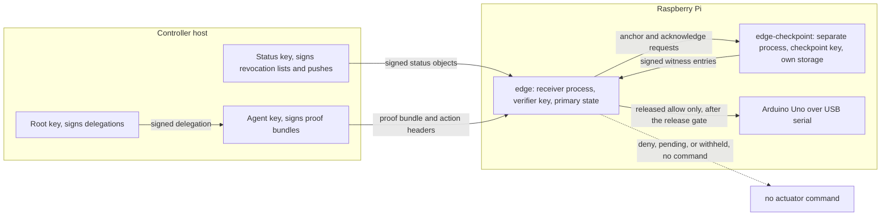

# Protocol v2 design of the edge receiver

This note records how the edge receiver uses the Ratify Protocol v2 C ABI
(`sdks/c`, `2.0.0-alpha.1`), which parts of SPEC-v2 it implements, and which
properties a Raspberry Pi without a secure element does and does not provide.
It is the place to check before relying on any claim in the README.

## Processes and keys

| Key | Held by | Signs | Pinned by the receiver as |
| --- | --- | --- | --- |
| Root | principal (controller) | delegation certificates | complete public key in `root_pub.json` |
| Status | principal's status publisher | revocation lists and pushes | complete public key in `status_pub.json`, bound to the root at epoch 1 |
| Agent | agent (controller) | proof bundles | complete public key in `agent_pub.json`, bound into every challenge |
| Verifier | receiver (`state/verifier.key`) | verification receipts | its own key, role `verifier` |
| Checkpoint | checkpoint process (`checkpoint.key`) | witness entries carrying anchors and acknowledgements | complete public key in `checkpoint_pub.json` |

Each key has one role. The receiver records the roles in its anchored
`SecurityJournalV2` (`issuer`, `delegation`, `verifier`, `witness`, and the
root's status key) and refuses a trust directory in which any key appears
twice. In the v1 receiver the pinned operator key also signed the revocation
list; v2 refuses that arrangement in two places, and the scenario matrix checks
both: the status publisher will not configure the root key as its own status
key (`status_object_rejected`), and the receiver will not start from such a
trust directory.

## Decision path

1. `GET /challenge`: the receiver validates the action, derives its session
   context (see `edge/src/actx.h`), and issues a challenge through
   `ratify_v2_issue_challenge`, binding the expected agent and the session
   context. The issuance record is persisted, and anchored, before the
   challenge is returned.
2. `POST /action`: size bound, trusted clock, `recovering` check, post-boot
   quarantine for `physical:actuate`, strict decode, issuance lookup, then
   `ratify_v2_verify_proof_bundle` with C callbacks for the claim store,
   trust provider, status evidence provider, and journal store, and the
   standard `com.ratifyprotocol.max_count/v1` evaluator.
3. A committed outcome is published: the sealed outbox body is signed with
   `ratify_v2_sign_prepared_verification_receipt`, checked with
   `ratify_v2_verification_receipt_append`, anchored, and submitted to the
   checkpoint, which acknowledges it with a signed witness entry.
4. `ratify_v2_release_decision` re-reads the acknowledgement from the
   checkpoint and either releases or reports pending, withheld, or rejected.
5. A released `allow` for `physical:actuate` is checked against local policy
   (zone allowlist, duration cap). Only then, immediately before the serial
   write, `ratify_v2_released_allowed` reads the authoritative clock; only a 1
   there hands the process-random actuator token to `actuator_fire`.

Nothing earlier than step 5 can reach the actuator. A committed outcome, a
receipt, and an acknowledgement are not actionable.

## Protocol v2 features used, and not used

| Feature | Used | Notes |
| --- | --- | --- |
| v2 keys and delegation certificates | yes | complete keys, 256-bit key IDs |
| `physical:actuate` scope | yes | `infrastructure:monitor` allowed without actuation |
| `resource_path` constraint | yes | `resource_id` = zone, `path_prefix` = `/` + resource |
| Duration ceiling | as an extension | `com.ratifyprotocol.max_count` with counter `duration_ms`, evaluated by the standard `max_count/v1` profile; v2.0 has no registered activation-duration constraint |
| Local duration cap and zone allowlist | yes | device policy, narrows only |
| Geofence | no | geo constraints are v1 only until Protocol 2.1; a zone here is a lexical resource identifier, not a location |
| Issuance helper | yes | expected agent and session context bound at issuance |
| Context policy | yes | `ratify.edge-sentinel.action/v1`, bound, six required fields |
| Signed status | yes | separate status key, genesis list staged at initialization, pushes staged over `POST /status` |
| Stateful verifier with C callbacks | yes | claim, release, checkpoint, clock, issuance, journal |
| `max_rate` | no | no rate store is configured, so a certificate carrying `max_rate` cannot be allowed (`constraint_unverifiable`) |
| Streams | no | the claim store refuses stream fields |
| Receiver audience | no | no audience provider |
| Lease-expiry recovery | yes | `store_drain` recovers expired evaluating claims; not exercised by the matrix |

## Single-device offline profile (SPEC-v2 §7.13)

The receiver is built in the shape of the profile: the checkpoint is a
separate process with its own key and its own storage, every durable change to
the receiver's security state is anchored before it takes effect, receipts are
acknowledged by the checkpoint before release, and a receiver whose state does
not match the anchored digest stays `recovering`.

**This deployment does not conform to the profile, and must not be described
as conforming.** SPEC-v2 §7.13 states that a second process on the same host
never qualifies as the independent checkpoint, and that is what this is. Two
further differences are deliberate and also rule out a conformance claim:

- The anchored digest is SHA-384 over the receiver's own state file under the
  label `ratify-edge-sentinel/primary-state/v1`. It is not the normative
  complete-state projection and does not reproduce
  `testvectors/v2/device-state.json`.
- Recovery authority is not implemented. A `recovering` receiver is returned
  to service only by an operator re-provisioning both processes, which is the
  same operation an attacker with root could perform.

### What the separate process does and does not provide on a Raspberry Pi 2

The Pi has no secure element and no TPM. The checkpoint's key and storage are
files on the same SD card as the receiver's.

| §7.13 component requirement | On this Pi | Why |
| --- | --- | --- |
| 1. Own key the primary cannot read or use except by asking | Partly, only when the checkpoint runs as a separate Unix user | File permissions keep the receiver's user from reading `checkpoint.key`. Root, a kernel compromise, or removal of the SD card defeats it. In the scenario matrix both processes run as one user, so it is not provided there. |
| 2. Anchored digest replaced only through a matching previous digest; per-sequence records | Yes, by the checkpoint's logic | Enforced in `checkpoint.c`; the receiver verifies each signed answer and a fresh nonce. |
| 3. Monotonic, no restore lowers the head, restore detectable | No | Root or an offline edit of the SD card can roll back the receiver and the checkpoint together, consistently, and nothing on the device can detect it. The two processes also share one update path. |
| 4. Durable before answering, identical retry returns the original, freeze on a fork | Yes, by the checkpoint's logic | fsync and rename before answering; identical retries return the stored entry; a different entry hash at an acknowledged sequence freezes it. Fork freezing is not exercised by the matrix. |
| 5. Never overwrites, refuses when full | Yes, by the checkpoint's logic | Capacity is a fixed count (default 10000 acknowledgements). Not exercised by the matrix. |
| 6. Timestamps from the security clock, refuses on regression | Yes, with the DS3231 | Both processes read `/dev/rtc0` and keep their own high-water mark. The RTC is not tamper-resistant: root can set it. Setting it backward is detected; setting it forward can only make proofs expire early. |

What the separation does buy on this hardware: a restored backup or edited
copy of the receiver's state is detected at startup (the matrix restores an
earlier state directory and the receiver stays `recovering`); a receiver
process that loses or rewrites its own records cannot extend the anchored
state; no decision is released until a different process, holding a different
key, has acknowledged the signed receipt; and the release invariant holds
offline. What it does not buy: any protection against root on the Pi, against
physical access to the SD card, or against whoever controls the software
update path. SPEC-v2 §7.13 names the components that can qualify: an
independently programmed secure element, a TPM-backed component with
authenticated non-volatile storage that covers the digest as well as the
sequence, or a separate append-only medium with independent write control.

## Clock

The production binaries read only the DS3231 RTC through `/dev/rtc0`; without
it there is no decision and no acknowledgement. The receiver's claim store and
the checkpoint each persist the greatest reading they have used, and a lower
reading fails closed (`clock_regressed`, no challenge issued). Following
SPEC-v2 §9.7, the receiver accepts challenges no older than 240 seconds,
which is the 300-second window less a 60-second drift budget for an RTC
without network time.

The 300-second post-boot quarantine is kept. In v1 it was the only defense
against replay across a restart, because consumed challenges lived in memory.
In v2 the claim store is durable, so a restart no longer forgets a consumed
challenge, and the matrix shows a replay after restart is still a replay with
no quarantine. The quarantine remains as a settling period for the RTC after
a power event: SPEC-v2 §7.2 has no boot-quarantine text, and a deployment that
cannot otherwise confirm its clock after power loss should keep one.

The test builds, and only the test builds, read a fixture clock from
`SENTINEL_TEST_CLOCK_FILE` and accept `SENTINEL_TEST_QUARANTINE_OVERRIDE=1`.
Every reading from the fixture clock is recorded as `clock_trusted=false`.

## Revocation exposure

Status is signed by the separate status key and staged on the device. The
genesis list and each push have a one-hour lifetime and the receiver accepts
status up to one hour old (`status_max_age_s = 3600`). A device that has not
received fresh signed status within that hour denies every request as stale.
The maximum revocation exposure is therefore one hour plus the time to
deliver and stage the push.

## Storage

Each process rewrites one state file per change (temporary file, fsync,
rename). The receiver's state grows by a few kilobytes per decision and the
checkpoint's by about 7 KB per acknowledgement; neither compacts. This keeps
the reference inspectable. A long-running deployment needs an append-only log
or a database, retention rules for expired claims (SPEC-v2 §7.3), and a
qualifying checkpoint.
